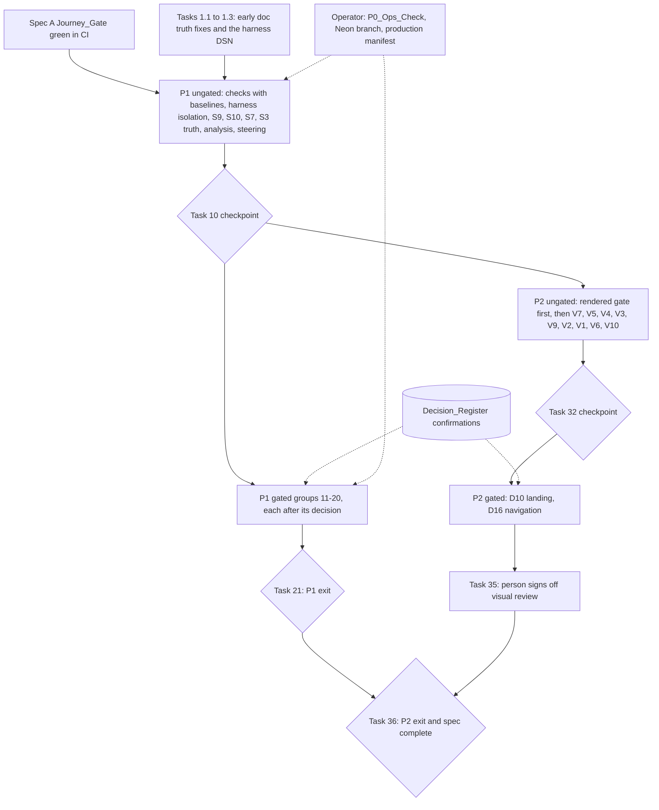

# Design Document: Platform Simplification and Polish

## Overview

This spec removes, freezes and corrects what the stack critique found, and raises the perceived quality of the admissions app, without adding product features. P1 (Requirements 1–11) simplifies the repository, the backend and the test setup. P2 (Requirements 12–21) fixes truthfulness, typography, layout, contrast and navigation on rendered pages. Requirement 22 holds the guardrails every change keeps.

The design has three working rules.

1. **Checks land before removals.** Every new CI check (routes versus callers, unreachable modules, doc paths, spec status, the rendered design gate) ships as a blocking job with a Check_Baseline of today's offenders. It fails on new offenders and on stale baseline entries. So the checks need no decision, and each confirmed removal shrinks a baseline instead of adding a check.
2. **Extend existing instruments; don't add parallel ones.** The repository already has a route walker (`scripts/inventory_admissions_v2.py`), a first-party import graph (`scripts/module-size-report.ts`), spec validators (`scripts/validate_spec_*.py`), a schema manifest tool (`schema_manifest`), a drift command (`check_schema_drift`), an axe sweep (`apps/admissions/tests/harness-e2e/required/axe-viewport-sweep.spec.ts`) and a source design gate (`scripts/design-audit-gate.ts`). Each new check is built on one of them.
3. **Visual work is distillation inside the existing system.** The product register governs the app and the brand register governs only the landing page. Every change uses Existing_Tokens and the `DESIGN.md` type scale, and keeps Inter and its fallback chain. Most fixes remove duplication rather than add components.

Grounding: HEAD `4a6c4ef`, the research dossier for this run (86 citations re-verified, none refuted), the critique revision 3 and its third review. Each file and line cited below was either read at HEAD while writing this design or re-verified at HEAD by the research dossier. Line numbers will drift; implementers re-find each site by its quoted code before editing.

### Key Design Decisions

1. **Gating protocol.** Decisions live in the Decision_Register in `requirements.md`. A Gated_Task's title starts with `[Blocked until Dn is confirmed]`. A decision becomes Confirmed when its status line records the option, the date and who chose it. If the user picks an option other than the lean, the affected tasks are rewritten to that option before they start; the register lists the delta for every option, so the rewrite is mechanical.
2. **Check baselines are data, with reasons.** Every allowlist or baseline is a JSON file under `scripts/`. Each entry needs a reason, and an entry that no longer matches an offender fails the check. Rejected alternative: inline `# noqa`-style markers in code. They scatter the decision record and cannot express "waiting for D5".
3. **Routes report reuses the real URL resolver.** It resolves Django's URLconf with the jobs-ops flag off and on, reloading the URL modules that read the flag at import, so gating is detected from real mounting rather than parsed from `urls.py` text.
4. **Test database from SQL (S7).** The baseline is a schema-only dump of the `public` schema of a Neon branch plus the `migration_history` and `django_migrations` rows. It replaces the model-generated `00_full_schema.sql`, and `apply_sql_migrations` applies later scripts on top. The suite replaces pytest-django's `django_db_setup`, so each test database is created empty and the baseline loads before Django's own `migrate`. Rejected: keeping model-built tables, which is today's fidelity gap; adopting Django migrations with a faked baseline (critique §4 row 14, option 2), a larger change to every deployment and out of proportion here.
5. **Lock files with pip-tools (S10).** `pip-compile --generate-hashes` keeps the `requirements.txt` interface that the Dockerfile and CI already use. Rejected: uv, which brings a second tool chain and lock format; Poetry, because the backend is a non-package application (`backend/pyproject.toml`).
6. **OCR opt-in in the existing `settings` table (S11, D4 option B).** A single key holds the opted-in institution ids. Rejected: a new `institutions` column, which is a schema change for a freeze; an environment allowlist, which keeps tenant configuration outside the database and outside the audit trail.
7. **Metadata endpoint reports features, not readiness (S3).** `status: "production_ready"` is replaced by `features.jobs_ops`, read from `ENABLE_JOBS_OPS_ROUTES`. Rejected: keeping `status` with a derived string; no honest value for "production readiness" exists in configuration.
8. **One readiness drives every wizard status (V3).** The stepper, the percentage and the incomplete alert all read the single Readiness that Spec A makes canonical (critique §8.2 R6.2). The server sorts next actions by wizard step in one place.
9. **Admin review becomes a route.** `/admin/applications/:applicationId` shows a pane beside the queue on wide screens and a full page on narrow ones. The body is extracted from the existing modal, so every control and guard is reused (V6).
10. **The rendered gate runs in Playwright on the harness.** One Playwright configuration, with a desktop and a mobile project, visits the Audited_Page_Set through the harness edge. In each page it runs axe, the measurement script and, last, impeccable 2.1.9's own browser detector (`cli/engine/detect-antipatterns-browser.js`), injected with `page.evaluate`. That is what the CLI's URL mode does internally, so the rule set is the CLI's. Rejected: the CLI's URL mode, because it always renders at 1280×800 (`detect-antipatterns.mjs:3573`), cannot hold a signed-in session, and its JSON names no element, so its findings could not be keyed by selector; scanning snapshots as HTML files, because that mode uses jsdom without layout; Impeccable's live overlay (`npx impeccable live`), which its `critique.md` reference describes as a visual aid for a person in a browser, not a CI instrument. The installed CLI 2.1.9 offers only `detect` and `skills`, and `detect --help` lists only `--fast`, `--json` and `--help`.
11. **Status tones follow `StatusPill`'s rule.** Text on a status tint is `text-foreground`, except the `muted` tone, which keeps `text-muted-foreground`; the tint, the border and an icon carry the status (admissions-v2 task 11.5, R16.2). An icon either takes the tone's base colour or inherits the text colour. `StatusPill`'s icons inherit it and the other components colour theirs; Requirement 18.2 allows both, so `StatusPill` keeps its look. Rejected: darker per-status text tokens (`--color-error-text`, `--color-accent-foreground`), because they would change `StatusPill` on every dashboard and roster, and the warning and success tones have no such token, so the map would mix two rules; and moving `StatusPill`'s icons to the base colour, which would change every pill with no contrast gain, because the inherited text colour already measures at least 9.41:1 on every tint (the `muted` tone over `--color-muted`; every other tone at least 14:1).

### Technology stack (locked)

| Layer | Locked choice | Notes |
|---|---|---|
| Backend | Python 3.12, Django 5, DRF, pytest, pytest-django, pytest-xdist, hypothesis | Tests on Postgres 17 (CI moves from 16) |
| Backend locks | pip-tools (`pip-compile --generate-hashes`), pinned to one release at least 14 days old | The only new development tool |
| Frontend | Bun, React 18, TypeScript, Vite, Tailwind, React Query, Zustand, Vitest, fast-check | No new runtime dependency |
| Browser checks | Playwright 1.58.2, `@axe-core/playwright` 4.11.1 (both already in `apps/admissions/package.json`) | Existing harness configs |
| Design detector | `impeccable@2.1.9`'s browser detector, `cli/engine/detect-antipatterns-browser.js` from a global install (`npm install -g impeccable@2.1.9`, the version CI's `design-audit` job already pins), injected into each Playwright page | No Puppeteer: `puppeteer` is only an optional dependency that the CLI's URL mode uses, so the gate's install step sets `PUPPETEER_SKIP_DOWNLOAD=1`. The CLI itself stays in the `design-audit` job for source scans |
| Schema baseline | Neon MCP (branch create, read-only dump), `pg_dump` 17 and an empty `postgres:17` container for the acceptance run | Operator-assisted; branch deletion needs your confirmation |
| CI | GitHub Actions, existing workflows | New jobs are blocking, without `continue-on-error` |

## Architecture



### Change scope by layer

| Layer | Main files | Nature of change |
|---|---|---|
| CI and scripts | `.github/workflows/ci.yml`, `spec-governance.yml`, `v2-harness-smoke.yml`, Spec A's `student-journey-gate.yml` (new `rendered-design-gate` job); new `scripts/routes_report.py`, `scripts/unreferenced-modules.ts`, `scripts/check_doc_paths.py`, `scripts/capability_inventory.py`, `scripts/rendered-gate-rules.ts`, `scripts/check-local-build-hosts.ts`, `apps/admissions/playwright.rendered-gate.config.ts`, `apps/admissions/tests/harness-e2e/rendered-gate/` | New blocking checks with baselines; rendered gate |
| Harness | `harness/bin/harness`, new `harness/bin/local-setup.sh`, `harness/Caddyfile`, `harness/adapters/adapter_server.py`, `apps/admissions/tests/harness-e2e/harness-fixtures.ts` | Ungated: widget stub, resource hints, outside-host gate, error-reporter DSN default. D2: the setup script with its prerequisite check, as the one bring-up path |
| Backend settings | `backend/config/settings/base.py`, `prod.py`, `staging.py`, `local_real.py` | Outbound defaults; the test-only broker and JTI Redis database; cache flags (D7) |
| Backend API | `apps/common/meta_views.py`, `apps/common/email_urls.py`, `apps/documents/urls.py`, `apps/applications/readiness_service.py`, `apps/catalog/program_views.py`, `apps/documents/document_storage_views.py`, `apps/accounts/admin_settings_views.py`, new `apps/documents/ocr_opt_in_views.py` | Metadata, gating (D1), next-action order, fee estimate, OCR gate and opt-in command (D4) |
| Backend tests | `backend/tests/conftest.py`, `backend/scripts/00_full_schema.sql`, `harness_bootstrap.py`, `apps/accounts/tokens.py`, new `apps/common/local_database.py` | SQL-built test database, isolation, local-database guard |
| Backend packaging | `backend/requirements*.in/.txt`, `backend/Dockerfile` | Lock files, runtime-only image |
| Admissions frontend | wizard (`pages/student/applicationWizard/**`), landing (`components/landing/**`, `lib/constants/landing.ts`), navigation (`routes/routeRegistry.ts`, `components/navigation/**`, `components/ui/BottomNavigation.tsx`), admin queue (`pages/admin/Applications.tsx`, `components/admin/applications/**`), tenant console, `index.html` and `vite.config.ts` (resource hints) | Truthful status, chrome, type, contrast, workspace |
| Jobs-ops frontend | `src/services/api/platform.ts`, `src/app/layout/JobsOpsShell.tsx`, `src/app/router.tsx` | Labels from metadata; "not enabled" state (D1) |
| Docs and steering | `.kiro/steering/*.md`, `.agents/AGENTS.md`, `DESIGN.md`, `REDESIGN.md`, `LOCAL-TESTING.md`, `docs/canonical-truth-map.md`, `docs/runbooks/*` | Current facts only; history moved to an archive |

## Decision handling

**Recording.** The user confirms a decision in conversation. The orchestrator then edits the decision's **Status** line in `requirements.md` to read `Confirmed <yyyy-mm-dd>: option <X> (<who>)`. Gated tasks check that line before starting. No task may infer a decision from silence.

**Interactions that constrain option choices:**

| Decisions | Constraint | Where it is enforced |
|---|---|---|
| D3 × D5 | Dropping the three `*.request_change` capabilities needs D5 option B, because the change-request submit authority uses them | Task 17.2 carries both markers |
| D7 × D14 | D7's removals need the P0_Ops_Check, which needs a reachable production host | Task 16.1 prerequisite |
| D14 × Requirement 7.2 | Comparing the baseline with the production manifest needs a reachable production host | Task 6.8 is gated on D14; task 6.1 lands the Neon baseline without it |
| D1 option C, D4 option C × Requirement 22.9 | `test_no_admissions_generative_ai_guard.py` asserts that the jobs-ops AI service and the server OCR dependencies exist; removing either requires rewriting the guard | Tasks under those options |
| D2 option D × S1 | The local-test stack must gain MinIO, Mailpit, the payment adapter and beat | Task 11.1 variant |
| D2 options A–C × Spec A's `harness journey-gate` | Task 11.1 makes that command call `local-setup.sh` for its bring-up, which changes a command Spec A delivers (Spec A design R9-a) | Confirming D2 confirms the change; task 11.1 starts it after Spec A's R9 tasks merge |
| D4 option B × the settings API | The generic settings reads accept any `admin` role, so the opt-in key must stay out of them; re-gating those reads is a capability change this spec does not make | Task 18.1; the known issue recorded by task 1.1 |
| D6 option B × symlinks | Thirteen `.kiro/skills/` entries are symlinks whose only content is in `.agents/skills/`; deleting a target deletes a kept skill | Task 15.1 rules; the symlink check of task 3.3 |
| D10 × Requirement 21.5 | The landing's nested cards are flattened once, by the landing restructure, under every option | Task 33.1 |
| D12 × P2 | If the student UI plan stays live, P2 student tasks check its open tasks for the same files first | Tasks 24–26, 31 |
| D9 × Spec A | Letter availability is decided by Spec A's renderer rule (`PROFILE_REQUIRED_DOCUMENT_TYPES`); this spec only writes copy that agrees, after Spec A's `[R7.4]` merges | Task 27.4 |

**Sequencing with Spec A that is not a decision.** Spec A's P0b (R7: the Approve gate, the conditions dialog and the decision copy) starts only when Spec A's journey gate is green, which is also when this spec starts. Tasks 30.2–30.4 rework the review modal that R7 changes (`ApplicationApprovalActions.tsx`), so they start only after Spec A's `[R7.2]` and `[R7.3]` clauses are merged, and each records the merge commit. Checkpoint 32 lists them while they wait.

Two harness items meet Spec A as well. The corrupted error-reporter DSN (§1) fails any harness run that clicks, Spec A's smoke baseline and Journey_Gate included, so task 1.3 may start at once. Task 11.1's change to Spec A's `harness journey-gate` waits for Spec A's R9 tasks and is confirmed with D2.

## Components and Interfaces

### 1. Documented local stack (Requirement 1, D2)

**Current state.** Four ways to run the backend exist:

| Stack | What it runs | Problem |
|---|---|---|
| `backend/docker-compose.yml` | web, celery, beat, local Postgres and Redis | Loads `backend/.env`, which points at the Neon authoring database and holds non-placeholder provider keys (research §3) |
| `backend/docker-compose.local-test.yml` | postgres, redis, web, celery | Documented by `LOCAL-TESTING.md`; no object storage, no mail capture, no beat; its storage knobs are read by nothing (A-01) |
| `backend/docker-compose.local-real.yml` | web, celery, beat, postgres, redis | Lenco sandbox; no object storage |
| `harness/` | Postgres 17, Redis, MinIO and its setup job, Mailpit, Lenco-shaped adapters, web, worker (concurrency 2), beat, Caddy | Driven by `harness/bin/harness` with `up`, `down`, `logs` and `smoke`; the only layer with real storage and a real browser |

**Ungated: the harness's own isolation (tasks 1.3 and 3.7; Requirements 1.11 and 1.12).** Spec A's Journey_Gate and the Rendered_Design_Gate run on the harness under every D2 option, so the harness half of C-08 and the error-reporter DSN land without a decision. Under options A–C, where the harness becomes the Documented_Local_Stack, they are also how it meets Requirements 1.3 and 1.9.
- **Error-reporter DSN (task 1.3, Requirement 1.12).**
  - `harness/bin/harness:76` defaults `VITE_GLITCHTIP_DSN` to a corrupted string: the words "email protected" in square brackets stand where a `key@host` pair was. It is the only such string in the tracked tree and arrived with the file in commit `b8ebdb5ab`. Many specs still allow requests to `harness-invalid.localhost` (for example `harness-smoke.spec.ts:26` and `payment-ownership-split.spec.ts:433`), which shows the intended host.
  - Sentry 10.52 rejects it. Its `DSN_REGEX` (`@sentry/core/build/esm/utils/dsn.js:8`) does not match, and `dsnFromString` then calls `console.error("Invalid Sentry Dsn: …")`, with no debug-build guard (`:37-46`), and sends nothing. Checked with Node against the installed 10.52.0: `makeDsn` returns nothing for today's default and logs that line.
  - The reporter loads on a page's first `pointerdown`, `keydown` or `scroll`, or after 15 s (`apps/admissions/src/main.tsx:36-62`). The harness console gate records every console error and warning (`harness-fixtures.ts:110`), and no spec allows "Invalid Sentry Dsn". So, Likely from the code and not run: every harness run that clicks, scrolls or stays on a page for 15 s fails at HEAD, Spec A's smoke baseline and Journey_Gate included.
  - The default becomes `https://harness@harness-invalid.localhost/1`, which Sentry's own `makeDsn` parses to host `harness-invalid.localhost` and project `1` (checked with Node). `*.localhost` resolves to loopback and is a stack host, so the outside-host gate does not record it. A clean run sends nothing there anyway: the reporter sends errors only (`tracesSampleRate: 0`, with the session and tracing integrations dropped, `apps/admissions/src/lib/errorReporter.ts:70-76`), and any error it would send has already failed the run through the console and page-error gates.
  - **Test.** `apps/admissions/tests/unit/harnessDsnDefault.test.ts` (`// @vitest-environment node`) reads the default from `harness/bin/harness`, loads `@sentry/core` relative to `@sentry/react` with `createRequire` (it is not a direct dependency of the app), and asserts that `makeDsn` returns a DSN whose host ends in `.localhost`, with `console.error` spied so that the run stays silent.
- **Card widget stub (C-08, task 3.7).** The adapter gains `GET /js/v1/inline.js`, a few lines that define `window.LencoPay.getPaid(config)` and call `config.onClose()` without charging anything, so the card option opens and reports a closed widget. `harness/Caddyfile` proxies `/__lenco/*` to the adapter with the prefix stripped, so the script is same-origin and passes the harness CSP (`default-src 'self'`). `harness/bin/harness` exports `VITE_LENCO_WIDGET_URL=/__lenco/js/v1/inline.js` beside its other `VITE_*` values (`:70-76`). Production builds do not set the variable, so they keep loading the live widget (`useLencoWidget.ts:49-53`).
- **Resource hints (Requirements 1.9 and 1.11, task 3.7).** The three `<link rel="preconnect">` lines leave `apps/admissions/index.html:26-28`. A small Vite plugin, `beanola-resource-hints` in `vite.config.ts` (a `transformIndexHtml` hook beside the existing `beanola-finalise-html`), emits them from configuration instead:
  - one `crossorigin` preconnect to the API origin, when `VITE_API_BASE_URL` is an absolute URL that is neither a local host nor the production app origin, which `getApiBaseUrl` treats as "same origin" (`src/lib/apiConfig.ts:27-59`);
  - one preconnect to the widget's origin, when the widget URL that `useLencoWidget.ts:51-53` resolves is absolute and not local.
  A production build whose `VITE_API_BASE_URL` is the production API origin therefore emits the same API and `pay.lenco.co` hints as today and drops the `pay.sandbox.lenco.co` hint, which production builds never use. The harness build emits none. Users see no difference.
- **Outside-host checks (Requirements 1.3, 1.9 and 1.11, task 3.7).**
  - **Static.** After `build_spa`, `harness/bin/harness` runs `scripts/check-local-build-hosts.ts`, which fails if `apps/admissions/dist/index.html` has a `<link>` whose `rel` is `preconnect`, `dns-prefetch`, `preload`, `modulepreload` or `stylesheet`, or a `<script src>`, naming a host outside the stack. Open Graph and Twitter `<meta>` tags are not requests and are not checked.
  - **Runtime.** `apps/admissions/tests/harness-e2e/harness-fixtures.ts` gains a fifth gate, outside hosts. A context-level `route('**/*')` aborts every request to a host outside the stack and records the host; a `request` listener records the same for any request that a page-level route lets through. A test with a recorded host fails and names the host, never the full URL. Stack hosts are `localhost`, `127.0.0.1`, `[::1]`, `*.localhost` and the compose service names `minio`, `mailpit` and `adapters`. The gate records a host whatever `allowRequest` says, so the `pay.lenco.co` allowances in today's payment specs (`student-lifecycle-golden.spec.ts:133-134`, `payment-ownership-split.spec.ts:435-436`, `two-tenant-golden-journey.spec.ts:143-144`) cannot hide a regression; once the stub lands, the CSP console error those allowances covered no longer occurs. A new probe in `tests/harness-e2e/gatecheck/` requests an outside host and proves the gate fires, as the existing probes do for the other four gates.
  - A preconnect is not a request that Playwright can see, which is why the static check exists.
- **Local databases (Requirement 1.5, task 6.6).** A new `backend/apps/common/local_database.py` exposes `require_local_database(command_name)`. It parses `DATABASE_URL` with `urllib.parse`, accepts only a Local_Database (an allowlisted host and non-production settings), and otherwise raises `CommandError(…, returncode=2)`. `harness_bootstrap` and `harness_seed_tenants` call it before anything else. It replaces `harness_seed_tenants`' four-string denylist (`:78-84`), which any other remote host passes, and absorbs the production-settings refusal that Spec A adds to that command (Spec A design R1-d). The settings test matters because the production web container also reaches its database as `postgres`.
**Leaned design (D2 A or B), task 11.1.** The harness becomes the Documented_Local_Stack.
- `LOCAL-TESTING.md` is rewritten around `bash harness/bin/local-setup.sh`, Spec A's demo seed (`harness_seed_tenants`, critique §8.2 R1.4; the web container runs `harness_bootstrap` and then `harness_seed_tenants` at boot, `harness/docker-compose.harness.yml:115-117`), signing in as the seeded student and admin, and `bash harness/bin/harness down`. `down` wipes the volumes, so every start begins empty (Requirement 1.1).
- **Prerequisites (Requirements 1.1 and 1.10).** Docker with Compose v2 (`harness/bin/harness:59` calls `docker compose`), Bun, Git, curl (`:101,115,127`) and python3 3.8 or later (the drain check at `:131` uses only the standard library). `harness/bin/local-setup.sh` checks each with `command -v`, and Compose v2 with `docker compose version`, before it starts anything, and exits 3 naming the first missing tool. The Playwright browser needs no step of its own: `harness smoke` installs Chromium itself (`:155`).
- **Outside hosts (Requirements 1.3, 1.6 and 1.9).** The document gains a table that states, line by line, where each concern goes on the stack:

  | Concern | Destination on the stack |
  |---|---|
  | Storage | MinIO |
  | Email | Mailpit |
  | Payment API | the Lenco-shaped adapter (`LENCO_API_BASE_URL`, `harness/harness.env:45`) |
  | Card widget | a stub script the adapter serves (task 3.7) |
  | Error reporting | nowhere: the backend has no DSN (`GLITCHTIP_DSN` is unset), and the frontend's DSN names `harness-invalid.localhost`, a loopback host where nothing listens (task 1.3) |

- **One bring-up path (Requirements 1.1 and 1.10).**
  - `harness/bin/local-setup.sh` checks the prerequisites, runs `bun install --frozen-lockfile` at the repository root, then runs `bash harness/bin/harness up` (build, `compose_up`, `wait_healthy`). It passes the caller's environment through: it sets no variable the caller has set, and `harness/bin/harness` reads every value as `${VAR:-default}`.
  - Spec A's `harness journey-gate` (Spec A design R9-a) exports its four gate values (`HARNESS_RATELIMIT_ENABLE=1`, `S3_SIGNED_URL_TTL_SECONDS=20`, `S3_PUBLIC_ENDPOINT_URL` and `HARNESS_BUCKET_ANONYMOUS=none`), then calls `local-setup.sh` in place of its own `build_spa`, `compose_up` and `wait_healthy`, and continues with `ensure_browser`, the storage check, the edge check, `run_journey_gate` and `drain_check`.
  - Why this order: running `local-setup.sh` and then the gate's own bring-up would wipe the documented stack and rebuild it with other values, because `compose_up` starts with `down -v --remove-orphans` (`harness/bin/harness:92-96`); and replacing the gate's bring-up with a script that reset the environment would lose the four values. With the environment passed through, the stack the gate tests is the stack the documented steps built.
  - Spec A's workflow (R9-e) still runs `bash harness/bin/harness journey-gate` and needs no edit. The command change is confirmed with D2 and made after Spec A's R9 tasks merge.
- **Keeping the document and the script in step.** `LOCAL-TESTING.md` shows the script's content in a fenced block marked `<!-- local-setup -->`, and a unit test (`scripts/tests/test_local_setup_doc.py`) fails if the block and the script differ. Every gate run then follows the documented steps on a fresh GitHub runner. The runner has more tools than the five prerequisites, so that run shows the steps work, and a unit test of the prerequisite check (`scripts/tests/test_local_setup_prereqs.py`, which runs the check with a `PATH` lacking one tool at a time and expects exit 3 naming it) shows each missing tool is caught. Together they are the evidence for Requirements 1.1 and 1.10.
- Task 11.2 retires `docker-compose.local-test.yml`, `docker-compose.local-real.yml` and the default `docker-compose.yml`, with their documentation. The default file goes too, because it is the one most likely to run a local stack against the Neon authoring database by accident.

**Under D2 D.** No stack is retired. The local-test stack gains the harness's MinIO, Mailpit, payment adapter and beat services, copied from `harness/docker-compose.harness.yml`, and `LOCAL-TESTING.md` stays its guide. Requirement 1.2 needs the adapter too. The dev server has no CSP, so `VITE_LENCO_WIDGET_URL` points at the adapter's published port. Spec A wires the storage settings, and task 3.7's resource-hint plugin and both outside-host checks apply unchanged. `local-setup.sh` brings up the local-test stack instead, and Spec A's `harness journey-gate` keeps its own bring-up, because the gate runs on the harness under every option. Requirement 1.1 then needs its own CI run of the Journey_Gate specs against the local-test stack; task 11.1's option-D variant adds it, or records Requirement 1.1 as not met if that stack cannot host them.

**Edge cases.**
- Ports already in use by another stack: `harness up` reports the conflicting port and exits non-zero (Docker's own error, surfaced by the script).
- The MinIO setup job fails: `wait_healthy` times out and `up` exits non-zero, naming the service and suggesting `harness logs <service>`.
- An ARM laptop: unverified. Task 11.1 records whether `harness up` works on one; the adapter image builds locally either way.
- A developer's shell already exports `VITE_LENCO_WIDGET_URL` or `VITE_API_BASE_URL`: `harness/bin/harness` uses `${VAR:-default}`, so the shell value wins, and the static host check then fails the run with the host named. `LOCAL-TESTING.md` says to unset them.
- A page-level route in a spec forwards a request to an outside host: the request listener still records it, so the gate still fails.

**Error handling.**
- A refused non-local database exits with code 2 and the message "Refusing to <command>: DATABASE_URL does not name a local database". The URL value is never printed, only its variable name.
- A missing prerequisite exits with code 3 and names the tool, before any container starts.
- An outside-host request fails the Playwright test and names the host; the static check exits 1 and names the element and the host.

### 2. Routes report and unreachable-module check (Requirement 2)

**Routes report** (`scripts/routes_report.py`, stdlib plus Django):
1. It imports `build_backend_route_catalogue()` from `scripts/inventory_admissions_v2.py` (`:464`), which walks the currently configured resolver with `_walk_urlpatterns`, so the report uses the real URLconf and does not copy the route enumeration. It does not call `collect_backend_routes()` (`:447`): that function's `_setup_django` sets `ENABLE_JOBS_OPS_ROUTES=1` in the environment (`:391`), so it always sees the flag-on surface.
2. It configures Django itself (`backend/` on `sys.path`, `config.settings.dev`, `django.setup()`), then builds the catalogue once per flag state. Before each build it enters `override_settings(ENABLE_JOBS_OPS_ROUTES=<state>)`, reloads `apps.common.email_urls`, `apps.documents.urls` and then `config.urls` with `importlib.reload`, and calls `clear_url_caches()`. `config/urls.py:69` reads the flag at import, and `config/urls.py:15-20` imports `document_urlpatterns` when it loads, so the two app modules reload first; this is the pattern of `backend/tests/unit/test_jobs_ops_endpoints.py:14-18`, extended to the two modules that read the flag under D1 option B. A route present only with the flag on is classified `gated`. A unit test asserts that at least one route differs between the two states (`/api/v1/jobs/` at HEAD), so a toggle that silently fails cannot pass.
3. **Normalisation.** Routes and callers are keyed by `(version, segments)`, so a v1 route cannot borrow a v2 caller with the same suffix.
   - A route's version is its mount prefix, `/api/v1` or `/api/v2`.
   - An admissions literal without a version prefix is v1, because the client prefixes `/api/v1` itself (`apiClient.request('/catalog/context/')`). An admissions literal that starts with `/api/vN/` is vN, because `toApiV1Path` passes versioned paths through unchanged (`apps/admissions/src/services/apiHelpers.ts:25,42`); `services/studentReadiness.ts:28`, for example, calls `/api/v2/student/applications/${…}/readiness/`. Jobs-ops passes full paths, so its literals carry their version.
   - The prefix is then stripped. Django converters (`<uuid:x>`) and template-literal expressions in frontend code (`${…}`) become a wildcard segment, and comparison is segment by segment within one version.
4. **Caller search.** It scans string and template literals in First_Party_Caller sources, using the same exclusion rules as `scripts/v1_surface_telemetry.py` (`--source` mode): production frontend only, no `generated/`, no tests.
5. **Classification.** Each route gets exactly one class, in this order of precedence: `caller`, `consumer` (External_Consumer_List), `gated`, `baselined`, `offender`. A route with more than one possible match is classified as the strongest class. An ambiguous dynamic path counts as `caller`, so a false positive never removes a real caller, and the report lists it under "possible callers" for review.
6. **Output.** A JSON artefact and a short table in the job log. The job exits 1 on offenders, stale baseline entries or invalid list entries.

**External_Consumer_List** (`scripts/route-consumers.json`). Each entry is `{route, methods?, consumer, owner, reason}`, and every field except `methods` is a required non-empty string. `route` must match a mounted pattern; otherwise the entry is stale and fails the check. Initial entries come from existing code:
- the Lenco webhook;
- the schema, docs and redoc endpoints;
- the error report endpoint, if no First_Party_Caller is found;
- the email delivery webhook, with reason "pending D1.b" until D1 is confirmed.

**Baseline** (`scripts/routes-report-baseline.json`). Each entry is `{route, reason, decision?}`. Today's offenders are expected to include the v2 demo views (D5) and the six change-request routes (D5); the first run produces the real list.

**Unreachable-module check** (`scripts/unreferenced-modules.ts`, Bun):
- `scripts/module-size-report.ts` already builds the first-party import graph. Its regex (`TS_SPECIFIER`, `:109`) covers `from`, static `import` and dynamic `import('…')`, and its resolver (`resolveTsSpecifier`, `:115`) handles the `@/` alias. The task exports `collect` and `resolveTsSpecifier` from that file without changing its report. The file ends with an unconditional `main()` (`:1024`), so importing it would run the size report; the task changes that line to `if (import.meta.main) main()`. The new script guards its own `main()` the same way, so tests can import its functions.
- Reachability starts at `apps/admissions/src/main.tsx` and ignores `tests/` and `*.test.*` files. A module that only tests import is unreachable.
- Allowlist (`scripts/unreferenced-modules-allowlist.json`): `{module, reason}` for files loaded by convention, such as `*.d.ts` and `vite-env.d.ts`.
- Baseline (`scripts/unreferenced-modules-baseline.json`). The first run replaces the critique's heuristic count (22 files, Likely) with a measured list. That list is the input for D15 item (d).
- **What the check cannot see.** Reachability is per module. It misses an unused export inside a reachable module, a callback that no caller invokes, and a module kept reachable only by a barrel re-export: `components/smoothui/index.ts` keeps `animated-counter.tsx` reachable for as long as the landing imports the barrel. The second half of `module-size-report.ts` runs `tsc --noUnusedLocals`, which finds unused locals and imports, not unused exports. This spec does not extend the check to export-level use. It lists such items by hand instead: D15 item (i), the upload paths Spec A freezes, and the smoothui barrel in task 33.2.
- **When an ungated change strands a module.** If a decision-independent task removes the last import of a module (task 29.1 removing the stats section, for example), the check reports the module as a new offender. That task adds a baseline entry naming the decision that owns the deletion (D10 for the landing's vendored modules, D15 (d) otherwise) and deletes nothing.

**Where the tests of these checks run.**
- `scripts/tests/test_routes_report.py` needs Django and hypothesis, which `spec-governance.yml` does not install: its validators are standard-library only (`:54-55`). It runs as a blocking step in `ci.yml`'s `backend` job after that job's dependency install, as `python3 -m pytest -p no:django scripts/tests/test_routes_report.py` from the repository root; the module configures Django itself.
- The TypeScript test lives at `apps/admissions/tests/unit/unreferencedModules.test.ts` with `// @vitest-environment node`, so the admissions job's existing blocking `bun run test` runs it, and `fast-check` resolves from the app's own dependencies (it is not hoisted to the repository root).

**Removals.** Each removal is gated (tasks 13 and 14).
- **v2 demo views (D5).** Remove their routes from `backend/apps/common/v2/urls.py` (`:15,27-39`), `demo_views.py` (467 lines) and their tests. Regenerate `backend/schema/openapi.v2.candidate.yaml` and `apps/admissions/src/generated/api.d.ts` with `scripts/generate-api-types.sh`. Update the canonical truth map's "V2 envelope codes" row if it names them. The v2 readiness path stays, because Spec A reads it.
- **Change requests (D5 option B).** Remove the six routes (`backend/apps/catalog/change_request_v2_urls.py`), the service and state machine (`change_request_service.py`), the outbox emitters, the six test files (1,907 lines) and the v2 onboarding views (528 lines). Remove the tenant console's "request change" affordances. `canonical_config_commands.py` stays, because platform admins call those commands directly. The `TenantChangeRequest` table is not dropped (additive-only schema rule). The truth map's "Tenant change requests" section and the steering paragraph are replaced by a dated note that finding TEN-06 is open again.
- **D15 (a), the frontend `@react-pdf` stack.**
  - Remove `apps/admissions/src/lib/pdf/` (24 code files and its 6 fonts and 2 PNGs), the dev preview pages that import it, its 12 test files and the `@react-pdf/renderer` dependency.
  - Remove the CI step "PDF chunk smoke check" (`scripts/check-pdf-chunk-load.mjs`), which only guards that chunk.
  - Rewrite `DESIGN.md` §2 "Print / PDF" to describe the backend renderers, the only official-document authority.
  - Keep `documentFlowDriftGuard.test.ts`'s rule (official documents only from the backend) and update its file list.
  - The admin `jspdf` exports stay (critique §4 row 17 (c)).
- **D15 (b), (c), (e).**
  - (b): remove `ApplicationDraftView` (`urls.py:86`) and `applicationService.saveDraft`, and update the truth map's "Compatibility draft payload" removal condition. The model stays (Requirement 2.10).
  - (c): repoint about 10 test imports and 20 `patch()` targets to the split modules (`student_views.py`, `admin_views.py` and the others), then delete `views.py`.
  - (e): delete `apps/website/` and `apps/student-portal/`, refresh `bun.lock` (the root `apps/*` workspace glob needs no edit), and remove their rows from `structure.md`.
- **D15 (i), the frozen upload paths (task 14.9).** Spec A's guard `apps/admissions/tests/unit/uploadPathSingleSource.test.ts` lists each dead path with the note "dead at HEAD 4a6c4ef; deletion owned by Spec B S2" (Spec A design R2-d). The task deletes:
  - `documentService.upload` (`services/documents.ts:6`);
  - `useWizardFileUploads.ts` and its export from the barrel `…/hooks/wizard/index.ts:7`;
  - the `startUpload` callback of `useApplicationFileUploads.ts` (`:281`, its storage call at `:301-305`), with `uploadApplicationFile` (`lib/storage.ts:121`) and `downloadFile` (`:289`), keeping any other export of `lib/storage.ts` that has a caller;
  - `lib/applicationSlipStorage.ts` and `lib/slipService.ts`, its only importer, which nothing imports.
  In the same change the guard's frozen list loses those entries, so the guard stays and becomes stricter. Each deletion is checked with `git grep` for the export name, because the module check cannot see an unused export in a reachable module.

**Edge cases.**
- A route called only through a constant in another module (`const PATH = '/x/'` then `request(PATH)`): the literal still matches, because the scan reads all string literals, not only call arguments.
- Generated type references (`paths['/api/v1/…']`) never count as callers.
- A test-only importer keeps a module unreachable. This is intended: test-only code is the critique's point.

**Error handling.**
- If the URLconf fails to load (missing settings), the report exits 2 with "cannot load URLconf: <exception class>". That outcome is never treated as a pass.
- An invalid JSON list exits 2, naming the file and the JSON error position.
- A baseline entry without a reason exits 1 and names the entry.

### 3. Jobs-ops truthfulness and freeze (Requirement 3, D1)

**Current state.**
- `PlatformMetaView` returns a hardcoded `"status": "production_ready"` (`meta_views.py:47`) with `Cache-Control: public, max-age=86400, stale-while-revalidate=3600`. Two property tests pin that header (`test_bug3_cache_control_exploration.py`, `test_bug3_preservation.py`).
- The only consumers are jobs-ops (`src/services/api/platform.ts:21`, `IntegrationsPage.tsx:120`) and tests (`test_platform_meta.py:15` asserts the hardcoded value).
- Seven seed and scaffold routes mount whatever the flag says (`email_urls.py:22-28`, `documents/urls.py:49-52`).

**Ungated design (task 7).**
- The metadata response becomes `{product, creator, developer, api_version, features: {jobs_ops: bool}}`. `features.jobs_ops` reads `settings.ENABLE_JOBS_OPS_ROUTES`, and `status` is removed.
- The serializer (`PlatformMetaSerializer`), `backend/schema/openapi.v1.baseline.yaml`, its lint baseline and the tests change in the same commit.
- The cache header stays, because it is pinned and harmless. The jobs-ops client requests this one endpoint with `cache: 'no-cache'`, so a flag change shows on the next page load.
- `platform.ts` maps `features.jobs_ops` to `features.jobsOps` in the `PlatformMeta` contract type and adds `source: 'backend' | 'demo'`. The demo-mode fallback (`platform.ts:5-11`, returned only when `VITE_JOBS_OPS_DEMO_MODE` is on and the request fails, `:31`) drops `'production_v1_seeded'`, sets `source: 'demo'`, and keeps `features.jobsOps: true` so the demo pages still render.
- `JobsOpsShell.tsx` drops the "Live backend" label (`:243`) and the readiness chips. One status line reads "Jobs-ops enabled" or "Jobs-ops not enabled" from `features.jobsOps` when `source` is `'backend'`, and "Demo data. Backend not reached." when it is `'demo'` (Requirement 3.2).
- `features.jobsOps` mirrors a backend field, so the truth map's "Platform attribution metadata" row registers the mirror, and a jobs-ops unit test fails if `backend/schema/openapi.v1.baseline.yaml` stops describing `features.jobs_ops` (Requirement 22.10).
- A unit test proves that `POST /api/v1/email/send/` resolves with the flag off (Requirement 3.4).

**Gated design, D1 option B (task 12).**
- `email_urls.py` always returns `send/`, and adds `accounts/zoho/connect/`, `messages/` and `threads/` only when the flag is on. `webhooks/delivery/` follows the answer to D1.b.
- `documents/urls.py` appends the four `job_views` routes only when the flag is on.
- Both modules read settings at import, the same way `config/urls.py:69` does. Tests toggle the flag with the pattern in `backend/tests/unit/test_jobs_ops_endpoints.py:7-32` (`override_settings`, `importlib.reload`, `clear_url_caches()`). They must reload `apps.common.email_urls` and `apps.documents.urls` before `config.urls`, because `config/urls.py:15-20` imports `document_urlpatterns` when it loads. The routes report (§2) resolves both flag states the same way.
- The blocking scope gate (`scripts/launch-verification/check-launch-scope.py`) adds these seven routes to its list of stubs that must be unreachable, so CI keeps enforcing the freeze.
- Jobs-ops frontend: a `FeatureGate` component at the router root (`src/app/router.tsx`) queries the metadata endpoint first. If `features.jobsOps` is false, it renders `JobsOpsNotEnabled` ("Jobs-ops is not enabled. An operator turns it on by setting `ENABLE_JOBS_OPS_ROUTES=true` on the backend.") and mounts no feature route, so no feature query runs (Requirement 3.6).
- If the metadata call fails, the gate renders an error state with Retry, still without mounting feature routes.

**Under D1 A.** The gating is skipped. Task 12.2 removes the right rail from `JobsOpsShell.tsx` (API base, creator, "Pinned references"); attribution stays in the backend metadata. Finishing jobs-ops is a separate spec.

**Under D1 C.** Task 12 becomes a move-out:
- `apps/jobs-ops/`, the five backend apps, `apps/common/jobs_ops_seed.py`, the 28 models and the `openai` requirement section leave the repository.
- The metadata endpoint stays in this backend and returns the attribution and the API version only, so the attribution stays visible under every option (Requirement 3.8).
- The product steering's attribution rule moves from its jobs-ops section to the platform section.
- The AI guard is rewritten to assert that no generative client exists anywhere.

**Edge cases.**
- An intermediary cache serves an old metadata body after a flag flip; there is no CDN today, so this risk only applies once one exists.
- The flag changes while a jobs-ops tab is open: the next feature call returns 404, and the client's existing error state shows. The gate re-checks on reload.

### 4. Repository contents (Requirement 4; D2, D6, D15)

**Ungated (task 3.6).** Add `.agents/tasks/` to `.gitignore`. Today only this clone's `.git/info/exclude:8` covers it (research R-15).

**Untracking evidence (D2 option B, task 11.3).**
- **Untracked types:** the raw artefact types of Requirement 4.1, under `docs/v2-evidence/`. Measured at HEAD (2,585 tracked files, 610 MB): traces `*.zip` (164 files, about 274 MB), raw logs `*.txt` (1,056 files, about 164 MB) and screenshots `*.png` (997 files, about 148 MB) are 96% of the bytes; the other raw types (`*.xml`, `*.js`, `*.html`, `*.jsonl`, `*.css`, `*.ttf`, `*.svg`, `*.webmanifest`, `*.before`, `*.after`, `*.err`, `*.exit`) add about 8 MB. No `*.log` file is tracked today; the rule covers the type anyway.
- **Kept:** `*.md` (139 files; every one of the 73 task directories keeps at least one), and the `*.json`, `*.yaml`, `*.csv`, `*.py`, `*.sh` and `*.ts` files that READMEs and validators cite, about 17 MB in all.
- **Method:**
  1. Remove the files from the index with `git rm --cached`; local copies stay on disk.
  2. Add `.gitignore` rules for those extensions under `docs/v2-evidence/`, so future runs cannot re-add them.
  3. A script lists every reference to an untracked file from a tracked Markdown file, Markdown links and backticked paths alike: the READMEs and other Markdown under `docs/v2-evidence/`, and every tracked Markdown file outside it. Outside the tree there are two at HEAD, both in `docs/runbooks/legacy-column-deprecation.md` (`:233` and `:291`, to `docs/v2-evidence/12.3/raw/*.txt`). Each file with such a reference gets a dated line: the raw artefacts were removed from the tree on `<date>` and remain in history at commit `<sha>`; references point to that commit's permalink. A reference in a file this spec may not edit (the D12 specs, Requirement 22.11) is listed in the evidence summary instead; there is none at HEAD.
- The evidence-dir convention already defaults to run-scoped output (`backend/tests/v2_evidence.py`, `apps/admissions/tests/harness-e2e/helpers/evidence-dir.ts`, guarded by `test_evidence_dir_convention_l8.py`), so tests need no change.
- `v2-harness-smoke.yml` writes `docs/v2-evidence/0.4/` (research §7 (e)). It switches to uploading a CI artefact only.
- Spec governance rule 1 needs at least one non-empty file in each evidence directory, which the READMEs satisfy. Task 11.3 runs both validators before the change and again in a fresh `git worktree` of the committed change, because `git rm --cached` leaves the files on disk and a run in the working copy would still see them. `spec-governance.yml` already triggers on `docs/v2-evidence/**` (`:21,30`), so the pull request runs them a third time.

**Cutting the launch-verdict rollup (D2 options A to C, task 11.4).**
- **Remove:**
  - the Gate 12 job and its "Report launch verdict" step (`ci.yml`, around `:640-745`);
  - the `collect-suite-results.py` steps, which only feed the rollup (`:204`, `:314`, `:453`);
  - `rollup.py`;
  - `docs/launch-evidence/rollup.json` and `launch-readiness.md`;
  - the operator-gate scripts that only feed the verdict. Each file is checked first with `git grep` so that no kept gate imports it.
- **Keep, blocking:** `check-contract-sync.py`, `run-brand-scan.py` and `brand_eval.py`, `check-launch-scope.py` and `scope_eval.py`, and `version_eval.py` (`backend-governance.yml:16,30`), plus the shared evidence-schema module they import.
- `docs/runbooks/launch-verification.md` is rewritten to describe only the kept gates.
- Tests of removed modules go with them, for example `backend/tests/property/test_launch_verification_performance.py`.

**Pruning skills (D6 option B, tasks 8.2 and 15).**
- Task 8.2 builds the keep-list. It greps for `.kiro/skills/<name>` and for skill names in:
  - `.kiro/steering/*`, `.agents/AGENTS.md`, `PRODUCT.md` and `DESIGN.md`;
  - `.kiro/hooks/*` and `.kiro/settings/*`;
  - every live spec's `tasks.md` and `design.md`.
- It then adds the three design skills and the skills this spec-authoring workflow used: spec-driven-workflow, senior-architect, tech-debt-tracker, copywriting, content-humanizer, copy-editing and a11y-audit. The keep-list is attached to D6 for you to confirm or extend.
- For each kept skill the keep-list records where its one real copy lives: a directory under `.kiro/skills/`, or the `.agents/skills/` target of a `.kiro/skills/` symlink (`git ls-files -s` mode `120000`; 15 at HEAD, 13 resolving).
- Task 15.1 then applies these rules, skill by skill:
  - kept, with a real directory in `.kiro/skills/`: nothing changes, except that `ui-ux-pro-max`'s second real copy in `.agents/skills/` is deleted;
  - kept, reached through a symlink: the content stays in `.agents/skills/<name>`, or moves into `.kiro/skills/<name>` with the symlink removed in the same commit. A directory that a kept entry resolves to is never deleted;
  - not kept: its `.kiro/skills/` directory or symlink is deleted, and so is the `.agents/skills/` target of that symlink, unless another kept entry links to it;
  - the two dangling symlinks (`playwright`, `playwright-best-practices`) are deleted;
  - `open-design`, which exists only in `.agents/skills/`, follows the keep-list like any other skill.
- `.agents/skills.json` keeps naming `.kiro/skills` as a skill root. The skill-path check (task 3.3) fails on any dangling symlink or missing `.agents/skills.json` path, and task 15.1 deletes the two baseline entries for the dangling links in the same change.

**D15 (f) and (g), task 14.**
- (f): delete `scripts/agenthub/`, `.agenthub/`, their five unit-test files and the integration smoke test.
- (g): run `git rm` on the two stray files, and `rmdir` the two empty untracked directories.

**Not in this spec.** The history purge (D2 option C, with D11).

### 5. Performance caches (Requirement 5, D7)

**Current state.**
- **Flags:** `PERF_CACHE_*` in `base.py:770-784`, set by nothing in prod, staging, deploy or harness (research B7).
- **Capabilities cache:** `catalog/services.py:1048` (branch in `get_capabilities`), the view wrapper at `accounts/admin_user_views.py:279-292`, and handlers in `accounts/signals.py`.
- **Dashboard cache:** `admin_user_views.py:532-533` and the dashboard handlers in `signals.py`.
- **Catalogue cache:** `catalog/_catalog_view_helpers.py:283` and `program_views.py:125`.
- **Modules:** `apps/common/scoped_cache.py` (343 lines) and `apps/catalog/catalog_cache.py` (109).

**Leaned design (D7 A), after the P0_Ops_Check.**
1. Remove the capabilities and dashboard cache branches, their handlers, their flags and their tests.
2. Remove `scoped_cache.py` once nothing imports it.
3. Remove or keep the catalogue cache per Requirement 5.3.
4. **Test triage:** a perf test file is deleted only when every test in it exercises a removed cache path. Otherwise only the cache-specific tests go. Tests that assert fail-closed authorization (`test_perf_capability_failclosed.py`) or count correctness (`test_perf_dashboard_counts.py`) are kept and retargeted to the uncached path. Task 16.1 lists each file's disposition before deleting anything.
5. `docs/runbooks/perf-flags.md` is rewritten. `deploy/.env.prod.example` and `backend/.env.example` lose the removed flags.

**Ungated (task 1.2).** `perf-flags.md`'s production column shows "Unverified" for any value no P0_Ops_Check has recorded.

**If the P0_Ops_Check finds a cache on in production.** The lean assumed the flags were off. The removal pauses, the finding is added to D7's register entry, and the decision is asked again with that data.

**Under D7 B.** Enable on staging, capture before and after with `backend/tests/perf_baseline/capture.py`, then decide per cache. **Under D7 C.** Nothing changes, and Requirement 5.1 is recorded as not met.

### 6. Steering, docs and spec metadata (Requirement 6)

**Doc path check** (`scripts/check_doc_paths.py`, stdlib).
- **Scanned files:** the steering files, `.agents/AGENTS.md`, `PRODUCT.md`, `DESIGN.md`, `LOCAL-TESTING.md` and `README.md`; for `.kiro/skills/<name>` paths only, also `.kiro/hooks/*` and every live spec's `tasks.md`.
- **Candidates:** backticked tokens and Markdown link targets that:
  - do not start with `/` (API routes such as `/api/v1/applications/`), `http`, `~` or `@` (npm scopes and the `@/` import alias);
  - contain none of `*`, `?`, `{`, `}`, `<`, `>`, `…`, `...`, `://` or whitespace;
  - are not a Tailwind opacity utility such as `bg-primary/50`;
  - and contain `/` or end in a known file extension.

  Before resolution a candidate loses a leading `./`, a `:<line>` or `:<symbol>` suffix after a file extension, a `::<test>` suffix, a `#anchor` and trailing punctuation.
- **Resolution:** against the tracked tree (`git ls-files`), because CI checks out only tracked files. A candidate with `/` is valid if it names a tracked file, or a directory that holds one, relative to the repository root, `backend/`, `apps/admissions/`, `apps/admissions/src/`, `apps/jobs-ops/` or `apps/jobs-ops/src/`; the steering writes backend paths as `apps/<app>/…` and frontend paths as `src/…` or `components/…`. A bare file name is valid if any tracked file has that name. A path that `git check-ignore --no-index` reports as ignored is valid too, because it is local-only by design, for example `backend/.env`.
- **Allowlist:** `scripts/doc-paths-allowlist.json` holds `{file, path, reason}` for paths that are absent on purpose.
- **Skill paths and links (Requirement 4.7):** `.kiro/skills/<name>` paths go through the same resolution. The check also reads `git ls-files -s .kiro/skills .agents/skills` and fails on any mode-`120000` entry whose target does not exist, and reads `.agents/skills.json` and fails on any `path` that names no directory relative to `.agents/` or the repository root (its two entries use one base each). The two dangling links start as Check_Baseline entries tied to D6.
- **First run.** A dry run of this rule at HEAD reports 31 distinct paths in 40 file-and-path pairs:
  - 6 stale references that tasks 1.1 and 9.x correct: `tokens.colors.cjs`, the `enterprise-tenant-authority` spec path (now under `_archived/`), `apps/librarymanagement/`, `useFeeResolver.ts`, `backend/apps/applications/tasks.py` (now a package) and `apps/admissions/public/fonts/pdf/`;
  - 14 entries in the structure steering's history tables, which task 9.1 moves out of the scanned files;
  - 11 names that are absent on purpose and get allowlist entries: four of the five "do not assume these exist" paths (`api/`, `api-src/`, `django_api/`, `src/utils/`), five retired names (`ai_cache.py`, `ai_circuit_breaker.py`, `ai_prompt_redactor.py`, `backend/apps/common/ai_service.py`, `tesseract.js`), the removed `MobileBottomNav.tsx` that the tenant layout table mentions, and the model-field descriptor `applications.institution/program/intake`.

  The fifth "do not assume" path, `src/`, is not reported: under the resolution roots above it names `apps/admissions/src/`, which holds tracked files, so it needs no allowlist entry, and an entry would fail the allowlist's own rule that the path be absent. It accounts for the two pairs (in `product.md` and `structure.md`) by which an earlier count of 32 paths in 42 pairs was too high. The figure of 30 in D's evidence (`evidence/d-arch/steering-path-existence.txt`) came from a looser rule and is superseded.

**Spec status check.** It extends `scripts/validate_spec_governance.py`; there is no new validator.
- A new `--enforce-status` mode applies one rule to every live spec, in both directions, as Requirement 6.3 states it: a spec marked completed fails if a required task is unchecked (today's rule 5), and a spec with at least one required task, all of them checked, fails if it is not marked completed.
- "Required" means a checkbox task not marked optional with `*`. That is what the validator already parses: its task pattern (`_TASK_RE`, `scripts/validate_spec_governance.py:128`) does not match `- [ ]*` lines. The admissions-v2 conventions `[-]` and `[~]` count as unchecked.
- The exceptions file is `scripts/spec-status-exceptions.json`: `{spec, reason}`, and each `spec` must be an existing live spec directory. Initial entries are the four D12 specs, with reason "D12 lean: record-only, not edited by Spec B".
- `spec-governance.yml` gains this mode as a blocking step. The existing informational `--all-specs` step stays.
- Metadata fixes in the same task, for specs outside D12 (D12's register entry records these edits):
  - `full-platform-remediation-2026-07` loses `"status": "completed"`, because 26 required tasks, its secret-rotation task among them, are open;
  - `beanola-launch-verification` (55 required tasks, all checked) and `communications-history` (45, all checked) gain it;
  - `student-payment-interview-pages` gets a `.config.kiro` with a fresh spec id, `workflowType` `requirements-first` and `specType` `feature` (it has `requirements.md`, `design.md` and `tasks.md`), and `"status": "completed"`: its 17 required tasks are checked, and its 6 open tasks are optional tests (`tasks.md:61-75`).
- A dry run of the two-way rule at HEAD fails exactly those four specs plus `profile-updates` (12 required tasks checked, 5 optional open), which is a D12 exception. With the fixes and the exceptions, the blocking step passes on the day it lands.

**Structure steering archive (task 9.1).**
- The history tables move verbatim to `docs/archive/steering-history-2026.md`, with a header naming the source commit and date.
- `structure.md` keeps the layout, the canonical truth map rule, the tenant authority layout, the spec markers, the monorepo rules, the placement tables, the testing layout and the "what not to copy forward" section.
- The archive is outside `.kiro/steering/`, so it is not loaded.

**Beat table drift guard (task 4.4).** `backend/tests/unit/test_steering_beat_table.py` parses the beat table in `tech.md` and compares its task names with the last dotted segment of each `CELERY_BEAT_SCHEDULE` entry's `task` value (`apps.common.tasks.cleanup_idempotency_keys_task` becomes `cleanup_idempotency_keys_task`). The table's `cleanup_idempotency_keys` row is corrected so the guard passes. Requirement 9.4 then cannot drift again.

**Decision-dependent wording.** Tasks 1.1 and 9.x write the current fact and name the pending decision (Requirement 6.5). The decided wording is written by that decision's task: 11.1 (D2), 12.3 (D1), 13.2 (D5), 15.2 (D6), 16.1 (D7), 19.1 (D8).

**Infrastructure identifiers.** Tasks add none. The existing ones are left for the D11 operator track (Requirement 6.6).

### 7. Test database built from SQL (Requirement 7)

**Current state.**
- The session fixture `unmanaged_schema` creates every `managed = False` table from models with `schema_editor.create_model`, then adds hand-copied partial and foreign-key indexes (`backend/tests/conftest.py:88-413`, the rest of the file). It depends on pytest-django's `django_db_setup` (`:89`), which has already created each test database and run `migrate`.
- All 78 project models are `managed = False`. `INSTALLED_APPS` also holds Django's admin, auth, contenttypes and sessions apps (`backend/config/settings/base.py:61-66`), whose tables `migrate` creates.
- `00_full_schema.sql` says "Generated dynamically from Django model definitions … Last regenerated: 2026-05-22", and `apply_sql_migrations` excludes it (`EXCLUDED_TOP_LEVEL_FILES`).
- On an empty database, `apply_sql_migrations` refuses to run (`MIGRATION_HISTORY_NOT_EXTENDED`, `apply_sql_migrations.py:655-664`). `harness_bootstrap` documents this gap and builds from models for the same reason (finding DATA-08).
- The schema manifest tool from admissions-v2 task 3.1 exists. Task 3.1's own rule is "Regenerate `00_full_schema.sql` only from a verified canonical database", and that regeneration never happened.
- CI uses Postgres 16; production uses 17.

**Design.**

1. **Baseline capture (task 6.1, operator-assisted).**
   - Create a Neon branch from the authoring default branch (Neon MCP `create_branch`), and tell the user its id.
   - Dump it with `pg_dump` 17: `--schema-only --schema=public --no-owner --no-privileges`, plus `--data-only --inserts --schema=public --table=migration_history --table=django_migrations`. Pinning `public` keeps out any other schema the authoring database may carry from its Supabase origin (Unverified).
   - Strip the psql meta-command lines (point 3), then run the whole session sequence of point 4 in an empty `postgres:17` container: load the result with `psql -v ON_ERROR_STOP=1`, then run `python manage.py migrate --noinput` and `python manage.py apply_sql_migrations` against that database. The capture is accepted only if all three succeed.
   - Why the whole sequence: production boots with `apply_sql_migrations` alone and never runs Django's `migrate` (`backend/Dockerfile:65`), and no script under `backend/scripts/` except the model-generated `00_full_schema.sql` creates an `auth_*` or `django_*` table. So whether the branch's Django tables agree with its `django_migrations` rows is Unverified, and tables without matching rows would make `migrate` fail with "relation already exists". If `migrate` fails, the capture leaves out Django's own tables (`--exclude-table='auth_*' --exclude-table='django_*'`, `django_migrations` and its rows included), so `migrate` creates them; no project table references them (point 5), and `BASELINE.md` records why.
   - Run `schema_manifest` against the branch. Every difference between the branch and the repository's scripts is explained in `backend/scripts/BASELINE.md`, or the capture stops.
   - Write the result to `backend/scripts/00_full_schema.sql`, with a header giving the Neon branch id, the capture date, the repository commit and "production parity: Unverified (task 6.8)".
   - Delete the Neon branch only after you confirm, because `delete_branch` is destructive.
   - The rest of S7 proceeds on this baseline. Requirement 7.2 stays open until task 6.8.

   **Production parity (task 6.8, gated on D14).** Once D14 names a reachable production host, the operator runs `schema_manifest` read-only against it. Every difference from the baseline is explained in `BASELINE.md` or fixed with an additive script proven on Neon first, and the header's parity line records the result and the date. Until then the P1 and final checkpoints list Requirement 7.2 as open.
2. **Generator.** `generate_full_schema.py` stops writing `00_full_schema.sql`. It prints model DDL to standard output for drift comparison, and its docstring says so.
3. **Meta-command lines.** Recent `pg_dump` releases emit `\restrict` and `\unrestrict` psql meta-command lines in plain-format output. A database cursor cannot execute them, so the capture strips them, and a unit test fails if any line of the baseline starts with a backslash.
4. **Session setup (task 6.2).** The baseline cannot load on a database pytest-django has already migrated: `migrate` has created `django_migrations`, `django_content_type`, the `auth_*` tables, `django_session` and `django_admin_log`, the Neon dump holds the same tables, and loading it would fail with "relation already exists". So `conftest.py` overrides pytest-django's `django_db_setup` and builds each test database in this order:

   ```python
   @pytest.fixture(scope="session")
   def django_db_setup(django_db_modify_db_settings, django_db_blocker):
       from django.conf import settings
       from django.core.management import call_command
       from django.db import connection
       with django_db_blocker.unblock():
           original_name = connection.settings_dict["NAME"]
           test_name = connection.creation._create_test_db(verbosity=0, autoclobber=True, keepdb=False)
           connection.close()
           settings.DATABASES[connection.alias]["NAME"] = test_name
           connection.settings_dict["NAME"] = test_name
           _load_baseline(connection)                         # 00_full_schema.sql, statement by statement
           call_command("migrate", "--noinput", verbosity=0)  # only migrations newer than the baseline rows
           call_command("apply_sql_migrations")               # only scripts newer than migration_history
       yield
       with django_db_blocker.unblock():
           connection.creation.destroy_test_db(original_name, verbosity=0)
   ```

   - `_create_test_db` creates an empty database and runs nothing. Depending on `django_db_modify_db_settings` keeps pytest-django's xdist suffix, so worker `gw3` gets its own `test_…_gw3` database.
   - The two `NAME` writes mirror Django's own `create_test_db` (Django 5.2.14, `django/db/backends/base/creation.py`), which this replaces. Its `createcachetable` call and its serialisation step are skipped: tests use an in-process cache, and no test uses `serialized_rollback`.
   - `migrate` runs without `--run-syncdb`. All project models are unmanaged, so it touches only Django's own apps.
   - The fixture also requests Spec A's database-host guard (the session fixture Spec A's task 2 adds), so that guard still runs before any database is created.
   - `--reuse-db` is not supported; every session starts from an empty database.
   - The hand-copied index block in `conftest.py` (`:119-413`) goes, because the SQL now creates those indexes.
5. **Isolation (task 6.3).**
   - pytest-xdist workers get separate test databases (point 4).
   - **Where the test values are set.** In settings, not in `conftest.py`. pytest-django implements `pytest_load_initial_conftests` with no ordering mark (pytest-django 4.12.0, `pytest_django/plugin.py:270-271`), while pytest's own implementation, the one that imports `conftest.py` files, is `trylast=True` (`_pytest/config/__init__.py:1214-1215`). So pytest-django runs first: it forces the settings import (`plugin.py:366`) and calls `django.setup()` (`:370`, then `:242`) before any `conftest.py` is imported. `base.py` reads `CELERY_BROKER_URL` from the environment when it is imported (`:171`), so an environment variable set later changes nothing. The values therefore live inside the `_is_testing` block that already switches the cache (`base.py:818-830`); `_is_testing` is true there because pytest is in `sys.modules` when pytest-django imports the settings. `dev.py`, the test settings module (`backend/pyproject.toml:41`), sets neither value after it imports `base`.
   - **Redis.** Under tests the cache is in-process (`base.py:818-830`), so cache and rate-limit keys are already per process. The only Redis client is the JTI blacklist, which builds it from `CELERY_BROKER_URL` (`apps/accounts/tokens.py:30-41`). A new setting, `JTI_REDIS_URL = os.environ.get("JTI_REDIS_URL", CELERY_BROKER_URL)`, defined next to `CELERY_BROKER_URL` (`base.py:171`), becomes the blacklist's source, so production behaviour is unchanged. Inside the `_is_testing` block:

     ```python
     from urllib.parse import urlsplit
     from django.core.exceptions import ImproperlyConfigured

     CELERY_BROKER_URL = "memory://"
     if int(os.environ.get("PYTEST_XDIST_WORKER_COUNT", "0")) > 7:
         raise ImproperlyConfigured("at most 7 xdist workers (Redis databases 9 to 15)")
     _xdist_worker = os.environ.get("PYTEST_XDIST_WORKER", "")  # "gw3" in worker 3, "" without xdist
     _jti_db = 9 + int(_xdist_worker[2:]) if _xdist_worker.startswith("gw") else 8
     JTI_REDIS_URL = (
         urlsplit(os.environ.get("REDIS_URL", "redis://localhost:6379/0"))
         ._replace(path=f"/{_jti_db}")
         .geturl()
     )
     ```

     pytest-xdist sets `PYTEST_XDIST_WORKER` and `PYTEST_XDIST_WORKER_COUNT` in each worker's environment before the worker parses its configuration (pytest-xdist 3.8.0, `xdist/remote.py:417-418`), so both are in place when pytest-django imports the settings in that worker. Database 8 serves a run without xdist and 9 + N worker `gwN`, clear of database 0, the default broker, and 1, the default cache (`base.py:171,284`). Redis has 16 databases, so a run with more than 7 workers stops as the settings load. `_replace(path=…)` keeps the host, port, credentials and query of `REDIS_URL`.
   - **Broker.** `CELERY_BROKER_URL` is `memory://` under tests (the block above), so tests stop enqueuing real messages (critique §7.3 item 12). This is safe only because the blacklist no longer reads the broker URL.
   - **Session check.** A session-scoped autouse fixture in `conftest.py` asserts that `settings.CELERY_BROKER_URL == "memory://"` and that `settings.JTI_REDIS_URL` ends in the database this worker should have, computed the same way from `PYTEST_XDIST_WORKER`. A regression then fails the run at once; two green `-n 6` runs alone could not tell, because they pass whether or not the values took effect.
   - **Teardown.** An autouse fixture runs after every transactional test (`transactional_db` or `django_db(transaction=True)`). At session start it computes the tables to clear: every table in `public`, minus the tables of managed models (`connection.introspection.django_table_names(only_existing=True)`, which Django's flush already resets before it re-creates its content types and permissions), minus `migration_history` and `django_migrations`. After each transactional test it runs `TRUNCATE … RESTART IDENTITY CASCADE` on that set, which closes the managed-false leak that Django's flush skips. The two sets share no foreign key at HEAD: no `managed = False` model and no SQL script references a Django table, and `AUTH_USER_MODEL` is Django's own `auth.User`. So the cascade cannot reach Django's tables, and a unit test pins that by checking that `django_content_type` and `auth_permission` still hold rows after a transactional test.
6. **Drift (task 6.4).** `backend/tests/integration/test_sql_schema_matches_models.py` runs `check_schema_drift` against the SQL-built database and fails on any table, column, type or nullability difference. The same command already runs at container boot (`backend/Dockerfile:65`).
7. **Fixing fallout (task 6.5).** Tests that relied on model-built leniency are fixed in the test, never by loosening a constraint. Each fix is recorded in the task's evidence summary.
8. **Harness (task 6.6).** `harness_bootstrap` switches to the same baseline-plus-scripts path. The Journey_Gate must stay green; if it fails, the switch is reverted and the cause recorded.
9. **CI (task 6.7).**
   - The backend jobs move to `postgres:17`.
   - A new job runs `pytest -n 6 backend/tests`, the whole tree, with a 30-minute timeout.
   - The existing narrow jobs stay unchanged, because branch protection may name them.
   - Evidence is two consecutive green runs on the pull request that lands it (Requirement 7.5).

**Edge cases.**
- A repository script missing from Neon's history runs in tests; that shows Neon lags the repository, and the task records it.
- A history row with no script file is ignored by `apply_sql_migrations`.
- SQLite cannot load Postgres DDL. The suite already runs on dev settings with Postgres (`backend/pyproject.toml` selects `config.settings.dev`), and `config/settings/test.py` stays untouched.
- A `pg_dump` newer than 17 can emit syntax that Postgres 17 rejects. The capture uses `pg_dump` 17, and the empty-container load in point 1 catches the rest before anything is committed.
- A developer runs a single test file without xdist: it uses Redis database 8 and one test database, the same path as a worker.

**Error handling.**
- A failing baseline statement aborts the session with its statement number and its first 200 characters. The baseline holds no row data apart from the two history tables, so nothing sensitive can appear.
- A failing script aborts with its file name, which `apply_sql_migrations` already reports.
- A non-Postgres `DATABASE_URL` aborts with "backend tests require Postgres 17", printing only the URL scheme.
- More than 7 xdist workers: the settings import raises `ImproperlyConfigured` naming the limit, so every worker stops before it collects a test (point 5).
- The test broker or JTI database is not in effect: the session check fails the run, naming the setting and, for `JTI_REDIS_URL`, the database number it expected; it never prints the URL, which can carry credentials (point 5).

### 8. Capability catalogue (Requirement 8, D3)

**Current state.** 17 `platform.*` and 17 `tenant.*` strings live in `services.py`. Counting references at HEAD (non-catalogue backend code against admissions frontend source):
- `platform.user.create_global` has no reference in either: no product code enforces it, and its only code reference is the catalogue entry (`services.py:959`). Five other files name it: `scripts/authority_matrix_registry.py`, which lists it as a composed capability of user creation and batch import (`:446,451,452`), `scripts/authority_matrix_v2.py`, the perf fixture `backend/tests/perf_baseline/fixtures/admin_scope.json:20`, `docs/canonical-truth-map.md` and `docs/tenant-admin-super-admin-permissions-plan.md`.
- `tenant.domain.read` is gated only in the UI (3 frontend, 0 backend).
- `tenant.profile.request_change` has 1 backend and 0 frontend references.
- `tenant.application.review` has 40 backend references.
- Fifteen of the 34 strings never appear in admissions frontend source, but the backend enforces most of them.
So "collapse to what the UI distinguishes" cannot be read as "delete what the frontend does not name".

**Ungated (task 8.1).** `scripts/capability_inventory.py` writes, for each capability:
- its backend enforcement sites (file and line);
- its frontend gates;
- the tests that name it;
- a proposed merge table, listing only candidates where two capabilities are always granted together and never distinguished by any gate;
- the update set of Requirement 8.5: every file `git grep -l '<capability>'` lists outside `.kiro/specs/`, `docs/archive/` and `docs/v2-evidence/` (6 files for `platform.user.create_global`, 20 for the three `*.request_change` strings at HEAD, including the authority-matrix scripts, the OpenAPI baselines and `apps/admissions/src/generated/api.d.ts`).
The output is attached to D3. The catalogue does not change.

**Gated (task 17), D3 B.**
- 17.1 removes `platform.user.create_global`.
- 17.2 removes the three `*.request_change` strings, only with D5 B.
- 17.3 applies the merge table you approve.

**Invariants.**
- The cross-tenant property tests stay unchanged (Requirement 22.1).
- The `CapabilitySet` shape and the `/api/v1/admin/capabilities/` response shape stay the same; only their contents change.
- Every catalogue change updates every file in that capability's update set in one commit, then runs `test_capability_endpoint_shape.py` and `test_capability_self_description_m3.py`, which check the capability endpoints without naming each string.

**Legacy grants.** A membership or grant row may still name a removed capability in its `permissions` JSON. Derivation already grants nothing for an unknown key: it looks keys up with `_GRANTED_MUTATION_CAPABILITIES.get(…, frozenset())` (`services.py:1015-1030`, lookup at `:1338`). Task 17.1 adds a regression test that a grant naming a removed capability yields no capability and no error.

**Under D3 A.** No change. **Under D3 C.** Out of scope: it changes the security model and needs its own spec.

### 9. Outbound defaults (Requirement 9)

**Settings changes (task 4.1).**
- `base.py` defaults become non-production:
  - `HEALTH_CHECK_URL` and `KEEP_ALIVE_URL` become `""`;
  - `FRONTEND_URL` becomes `http://localhost:5173`, the admissions dev server;
  - `EMAIL_HOST` becomes `localhost`, where nothing listens unless a developer runs a mail catcher. The harness sets its own values (`harness.py:97,130,135`).
- `prod.py` sets today's production values explicitly, so production behaviour does not change (Requirement 9.5).
- **Tests pinned to the old default.** `backend/tests/property/test_email_dispatch.py:276` asserts `https://apply.beanola.com` in a reset email with no settings override, and `dev.py` sets no `FRONTEND_URL`, so it relies on the base default this task changes. Task 4.1 gives it `override_settings(FRONTEND_URL="https://apply.beanola.com")`; `backend/tests/unit/test_outbox_helpers.py:118` already overrides the setting the same way. Any other test that the full run shows relying on the old default gets the same override, and the evidence summary lists it.
- **Staging (Requirement 9.7).** `staging.py` reads `FRONTEND_URL` and `HEALTH_CHECK_URL` from the environment with an empty default, so it no longer inherits production values, and adds both names to its list: `REQUIRED_ENV_VARS = [*REQUIRED_ENV_VARS, "FRONTEND_URL", "HEALTH_CHECK_URL"]`. Spec A's startup validation (Spec A design R1-b) checks that list in `CommonConfig.ready()` only when `STARTUP_ENV_VALIDATION` is true, which Spec A sets in `prod.py` and `staging.py` and turns off in `local_real.py`. A staging deployment without either variable therefore refuses to start and names it. Without Spec A's fix the list is never read (research R-1), which is one reason this work starts after Spec A (task 2). Today staging inherits production defaults, so a staging email links to production. `EMAIL_HOST` in staging keeps reading `ZOHO_SMTP_HOST`; without it, staging now gets the non-production base default.
- **Local-real and the harness.** `local_real.py` imports staging (`:20`) and `harness.py` imports `local_real` (`:32`), so both inherit staging's empty values. `local_real.py` sets local defaults after its import: `FRONTEND_URL = os.environ.get("FRONTEND_URL", "http://localhost:5173")` and `HEALTH_CHECK_URL = os.environ.get("HEALTH_CHECK_URL", "")`. Its env file sets neither name today (`backend/.env.local.real`, gitignored and loaded by `backend/docker-compose.local-real.yml:16-17`; names checked, not values). The harness keeps its own values (`harness.py:130,135`, fed by `harness/harness.env:53-54`).

**Tasks (task 4.2).** `keep_alive_task` (`backend/apps/common/tasks.py:320`) and `check_uptime_task` (`:344`) read their URLs with `getattr(settings, …, <production URL>)` (`:329`, `:358`), so each task carries a production fallback of its own. Both fallbacks become `""`, and an empty value returns early with one INFO log naming the setting (Requirement 9.2).

**Link helpers (task 4.2, Requirement 9.8).** Two production literals sit outside settings. `backend/apps/common/email_links.py:75` returns `getattr(settings, "FRONTEND_URL", "") or "https://apply.beanola.com"`, and `backend/apps/common/outbox.py:96` parses `getattr(settings, "FRONTEND_URL", "https://apply.beanola.com")`. Both literals go:
- `_get_platform_base_url()` returns the setting as it is. When it is empty, the function logs one WARNING per process naming `FRONTEND_URL`, never a value, and returns `""`, so email links are path-only instead of production links. The seven message modules under `apps/common/email/messages/` that call `platform_base_url()`, and its other callers, need no change.
- `_safe_action_url` reads the setting with an empty default. `urlparse("")` has no host, so with an empty setting no absolute action URL counts as same-origin, and the action URL is dropped, as it already is for any other host.
- Production sets the value (`prod.py`), staging refuses to start without it (Requirement 9.7), and local-real and the harness set their own, so an empty value is a misconfiguration. The change only stops it pointing at production.

**Tests (task 4.3).** `backend/tests/unit/test_settings_outbound_defaults.py` imports settings modules in subprocesses with `TESTING` and `PYTEST_CURRENT_TEST` removed from the child environment, the pattern of Spec A's `test_startup_env_validation.py`. It asserts:
- under `config.settings.staging`, with every other required variable set to a placeholder and `FRONTEND_URL` and `HEALTH_CHECK_URL` unset, `django.setup()` raises `ImproperlyConfigured` naming both, and stderr holds no placeholder value;
- `config.settings.local_real` and `config.settings.harness` start with both variables unset;
- no non-production module (`base`, `dev`, `test`, `staging`, `local_real`, `harness`) resolves `HEALTH_CHECK_URL`, `KEEP_ALIVE_URL`, `FRONTEND_URL` or `EMAIL_HOST` to the production API host, the production frontend host or the live SMTP host;
- `prod.py` keeps today's values;
- both tasks return without a request when their URL is empty, with `requests.get` patched to fail if it is called.

**CI build (task 4.5, Requirement 9.6, C-21).** The admissions job's environment falls back to the production API host when the repository variable is unset (`.github/workflows/ci.yml:333`). The fallback becomes `http://localhost:8000`. No CI step sends a request with that build: the job type-checks, tests, builds, and runs the bundle guard and the PDF chunk check, none of which reads the API host. The deploy workflow builds with its own variables (`deploy.yml:66`) and is unchanged.

**D15 (h), task 14.8.** Remove `keep_alive_task`, its beat entry (`base.py:185-188`), its setting, its tests and its steering row.

### 10. Lock files (Requirement 10)

**Files.**
- `backend/requirements.in` holds the runtime packages from today's `requirements.txt`, `cryptography` included: it sits under the "# Testing" comment today (`requirements.txt:59`), but `apps/common/audit_network.py:8` imports `cryptography.fernet` at runtime. It keeps the jobs-ops-only `openai` section with its comment.
- `backend/requirements-dev.in` holds `-r requirements.in`, `-c requirements.txt` and the test packages (`requirements.txt:51-58`), `factory-boy` among them (`backend/tests/factories.py:8` imports it, for `tests/unit/test_synthesized_legacy_documents.py`). The constraint line makes every package that both locks pin resolve to the runtime lock's version, so the image and the test jobs cannot drift apart.
- Both compile to `requirements.txt` and `requirements-dev.txt` with `--generate-hashes`.

**Resolution.** Compilation runs inside `python:3.12-slim`, the production base, with a pinned pip-tools release:
`docker run --rm -v "$PWD/backend:/w" -w /w python:3.12-slim sh -c "pip install pip-tools==<pinned> && pip-compile --generate-hashes requirements.in && pip-compile --generate-hashes requirements-dev.in"`.
The command is recorded in `tech.md` and in a header comment of each `.in` file.

**Image.** The Dockerfile runs `pip install --no-cache-dir --require-hashes -r requirements.txt`. A CI step builds the image and runs a short Python check inside it, which exits non-zero, naming the module or package:
- if any of `pytest`, `pytest_django`, `xdist`, `pytest_timeout`, `hypothesis`, `factory`, `freezegun` or `fakeredis` is importable;
- if any package that `requirements.in` names is not installed, checked with `importlib.metadata.version` on each line's distribution name, with extras, version specifiers and markers removed;
- or if `cryptography.fernet` does not import.

**Freshness.** pip-compile keeps existing pins found in its output file unless `--upgrade` is passed. So the check copies the lock to a temporary file, compiles against it, and diffs. The diff is empty unless a `.in` file changed without recompiling (Requirement 10.5), and new upstream releases do not fail the check. The same step also fails, naming the package, if a package pinned in both `requirements.txt` and `requirements-dev.txt` has two different versions, which catches a lock edited by hand.

**CI.** Test jobs install `requirements-dev.txt` with `--require-hashes`. Governance jobs that import Django install the same file.

**Edge case.** Host virtual environments on Python 3.14 (the skew in critique §7.1) may lack wheels. `tech.md` states that host virtual environments use Python 3.12, matching `requires-python`.

### 11. OCR opt-in (Requirement 11, D4)

**Current state.** The wizard starts OCR after a result-slip upload. `useWizardController.ts:614` calls `startOcrPollingRef`, and `:874-890` sets up `useOcrGradeExtraction`. The backend's `DocumentExtractView` (`document_storage_views.py:623-662`) authorizes through `_get_authorized_document`, then enqueues `extract_document_text_task`. That view is the only place in `backend/apps` that enqueues the task.

**Design (D4 B).**
- **Policy.** `apps/documents/ocr_policy.py` exposes `is_ocr_enabled_for_institution(institution_id) -> bool`.
  - It reads the `settings` row `documents.ocr_enabled_institution_ids` (`apps/common/models.py:69-84`): a JSON array of institution UUID strings, category `documents`, `is_public` false.
  - A missing row means an empty list, so OCR is off everywhere. That is the freeze.
  - A malformed value (not a list, or a non-UUID entry) is treated as empty, and one WARNING is logged per process, naming the key and not the value.
- **Endpoint.** In `DocumentExtractView.post`, after the scoped authorization (so a non-owner still gets the masked 404 first), resolve `application.institution_id`. If that institution is not opted in, return 409 with code `OCR_NOT_ENABLED` and the message "Automatic grade reading is not turned on for this school. Enter your grades by hand." No task is enqueued.
  - A missing `institution_id` (a legacy snapshot-only row) counts as not opted in.
  - The new code is registered in `apps/common/error_codes.py` and the truth map.
- **Task re-check.** `extract_document_text_task` checks the policy again when it runs, and exits with status `not_enabled` if the institution opted out after queuing.
- **Contract.** The required-documents contract (`backend/apps/applications/required_documents.py:404-420`) gains a contract-level `ocr_available: bool`. The client type in `apps/admissions/src/lib/requiredDocuments.ts` and the generated types follow. Register the field in the truth map with a drift guard.
- **Wizard.** It starts OCR, and polling, only when `contract.ocr_available` is true. The manual grade form renders first on every tenant and stays usable while OCR runs.
- **Who can change it.** A dedicated command owns the key (Requirement 11.4):
  - `GET` and `PUT /api/v1/admin/documents/ocr-opt-in/`, in a new `backend/apps/documents/ocr_opt_in_views.py`, listed in a new `ocr_admin_urlpatterns` in `apps/documents/urls.py` and mounted under `/api/v1/admin/` beside `fee_admin_urlpatterns` (`config/urls.py:55`).
  - `permission_classes = [IsAuthenticated, HasPlatformCapability]` with `required_capability = "platform.settings.manage"`, the contract of `backend/apps/catalog/permissions.py:97-144`, so authority resolves through `AdminCapabilityService` and a denial is audited and non-revealing.
  - The `PUT` body is `{"institution_ids": [<uuid>, …]}`: required, a list of UUID strings with no duplicates, each naming an existing institution, and no longer than the number of institutions. Anything else is a 400 `VALIDATION_ERROR` naming the field, and nothing is written.
  - In one transaction the `PUT` writes the `settings` row, creating it on the first write, and calls:

    ```python
    TenantAuditService.record_event(
        action=ACTION_SETTINGS_CHANGED,            # "settings.change"
        entity_type="setting",
        entity_id=setting.id,                      # the row's UUID, never the key
        actor_id=getattr(request.user, "id", None),
        actor_role=getattr(request.user, "role", None),
        metadata={"key": "documents.ocr_enabled_institution_ids", "before": [...], "after": [...]},
        request=request,
    )
    ```

    The calling convention is the one at `apps/accounts/admin_user_views.py:508-509`. `record_event` stores `entity_id` and `actor_id` through `_coerce_uuid`, which returns `None` for a string that is not a UUID (`apps/catalog/tenant_audit_service.py:179-188,263,265`), so the object id must be the row's UUID (`Setting.id` is a `UUIDField`, `apps/common/models.py:72`), and the key goes in the metadata. `settings.change` is the event the authority matrix already registers for the settings routes (`scripts/authority_matrix_registry.py:454-455`), so there is one action name for settings writes; a constant `ACTION_SETTINGS_CHANGED = "settings.change"` joins the others in `tenant_audit_service.py`. The actor's role goes into the row's `changes` as `actor_role`, which `record_event` already does. Institution ids are not PII.
  - Responses use the success envelope. The route is registered in `scripts/authority_matrix_registry.py` as a `platform.settings.manage` route with `audit_event="settings.change"`, and in `scripts/route-consumers.json` with consumer "operator, through the API" and reason "D4 opt-in command; no UI in this spec", because no first-party caller exists. The runbook `docs/runbooks/multi-tenant-operations.md` shows the call. A super-admin control for it is a follow-up.
- **The generic settings endpoints leave the key alone.** In `backend/apps/accounts/admin_settings_views.py`:
  - the list and detail reads omit the key, and the detail read answers 404 for it as for any missing key, because those reads accept any `admin` role (`IsAdmin`, `:224,314`) and the list names other schools;
  - `post`, `patch` and `delete` for the key return 403 `KEY_MANAGED_ELSEWHERE` ("This setting is changed through its own command."), registered in `apps/common/error_codes.py` and its frontend mirror;
  - import lists an entry for the key under its existing per-entry `errors` and writes nothing for it;
  - reset keeps the key's row. Today it deletes every row and recreates the guided defaults (`:443-470`, the deletion at `:457`), which would silently turn OCR off everywhere.
- **Known issue, not changed here.** The writes already require a super admin, but through the role string (`_settings_write_forbidden`, `:60-79`) rather than `platform.settings.manage` through `AdminCapabilityService`; the reads accept any `admin` role. The admissions route registry opens the settings page to super admins only (`routeRegistry.ts:375-381`), and the authority matrix registers the four routes as `platform.settings.manage` (`scripts/authority_matrix_registry.py:454-457`). Re-gating the reads takes access away from tenant admins, a capability change that needs its own decision, so task 1.1 records both points under "Known Open Issues" in `tech.md`.

**Under D4 A.** Nothing in this spec. **Under D4 C.** Removal of the task, the Tesseract packages in `backend/Dockerfile:9-14`, `pytesseract`, the hook and their tests, with the AI guard rewritten (Requirement 22.9).

### 12. Visual design direction (Requirements 12–21)

This section applies design-for-ai in APPLIER mode, constrained to the existing system.

**Phase 0, context.**
- Register: product for every app surface, brand for the landing page only (`PRODUCT.md` mode selector).
- Scene for the app: a first-time applicant on a budget Android phone at home in the evening, on a slow mobile connection, finishing the form across several short sessions.
- Scene for staff: an admissions officer at a desk on a wide monitor, clearing 150 applications a day.
- These scenes keep the light theme (dark mode is disabled at the HTML level), high contrast, 16 px body text and a dense admin table.

**Phase 1, foundation.** The personas from the critique's design workstream:
- Mwila, 19, a first-time applicant on a budget Android over 3G;
- Mrs Banda, an admissions officer handling 150 applications a day.
Primary use cases: find an open programme and start; finish one wizard step per session; know the single next step; review and decide quickly.

**Phase 2, structure.**
- Spacing stays on Tailwind's 4/8 scale. Type stays on the `DESIGN.md` scale (12, 14, 16, 18, 20, 24, 28, 32 px). Neighbouring steps differ by a ratio of about 1.11 to 1.20, the tighter product-register range in Impeccable's `typeset` reference, so headings skip a step to stay distinct (24 px over 16 px body is 1.5).
- No new scale. Prose containers get `max-w-prose` (65ch).

**Phase 3, typography.**
- Inter stays: the product register allows it, and the tech steering mandates its fallback chain. Detector findings `overused-font` stay baselined with that reason.
- Hierarchy comes from size and the existing weights 400 and 600. On mobile, the page H1 is 24 px, section headings 20 px and body 16 px; on desktop, the H1 is 28 px.

**Phase 4, composition.** One dominant element per screen:
- wizard: the form;
- dashboard: the next-action card;
- admin: the queue table;
- landing: the hero's primary action.
Hierarchy is set in the order whitespace, weight, size, then colour. Nested cards are removed: a card is used only for an independent, actionable unit (`DESIGN.md` §4, one container deep).

**Phase 5, colour.**
- Strategy: Restrained, using Existing_Tokens only.
- Status tones come from one map, `StatusPill`'s rule (key decision 11), generalised into `apps/admissions/src/lib/statusTone.ts`. For each tone it gives the tint (`bg-<tone>/10`, with `bg-muted` for `neutral` and `bg-muted/60` for `muted`), the border (`border-<tone>/40`), the text class (`text-foreground`, and `text-muted-foreground` for `muted`) and an icon class (the tone's base colour, and `text-accent-foreground` on the accent tint), taken from `components/ui/StatusPill.tsx:36-43`.
  - `StatusPill` takes the tint, border and text classes from the map, and its icons keep inheriting the text colour (`:46-56,78`), which Requirement 18.2 allows. Its colours and icons therefore do not change; only its mobile type size does, under Requirement 16.1 (task 24.7).
  - `Alert`, `DocumentChecklist` and the wizard's document rows use the whole map, icon class included. `Alert` today sets tone-coloured text on 5% tints (`components/ui/Alert.tsx:12-16`), which the map's text and tint replace; its icons already take the tone colour, and keep it.
- **Alpha-modified text tokens (Requirement 18.3, task 23.2).** The 23 uses at HEAD become full tokens:

  | Found at HEAD | Uses | Becomes | Ratio on white |
  |---|---|---|---|
  | `text-muted-foreground/30` to `/70`, one with `placeholder:` | 10 | `text-muted-foreground` | 10.31:1, from 1.71:1 to 4.33:1 |
  | `text-foreground/80` and `text-foreground/60` | 5 | `text-muted-foreground` | 10.31:1, from 9.54:1 and 4.70:1 |
  | `hover:text-primary/80` | 6 | `hover:text-link-hover` (`--color-link-hover`, `#1d4ed8`) | 6.70:1, from 3.62:1 |
  | `text-destructive/70`, on an icon (`components/student/PaymentForm.tsx:538`) | 1 | `text-destructive` | 4.83:1 |
  | `hover:text-destructive/80`, on a button that is already underlined (`WizardErrorSummary.tsx:75`) | 1 | removed: the underline marks the button | none |

  `text-white/50` to `text-white/90` (25 uses) are Tailwind palette colours, not tokens, so Requirement 18.3 does not cover them. The live ones sit on `bg-foreground`, on the shared footer, the desktop sidebar and the public tracker header (`components/layout/SharedFooter.tsx:53`, `components/navigation/DesktopSidebar.tsx:111`, `pages/public/tracker/components/ApplicationStatusHeader.tsx:74`), where they measure 5.23:1 to 14.54:1, and axe's `color-contrast` rule measures the composited colour, which is a hard guardrail at P2 exit (Requirement 19.9). The two in `components/ui/PageHeader.tsx` belong to its `gradient` variant, which no caller uses. Replacing them would change those surfaces for no contrast gain, so this spec leaves them.
- Contrast for each pair, computed from the hex values with the WCAG 2 formula, as Property 6 does:

  | Pair | Ratio |
  |---|---|
  | `#0f172a` (`--color-foreground`) on the error-chip tint `#f0ebee` | 15.15:1 |
  | `#0f172a` on the info tints `#e7eef8` and `#edf2fa` | 15.29:1 and 15.88:1 |
  | `#0f172a` on the warning tints `#f8eee6` and `#f4e6dc` | 15.61:1 and 14.62:1 |
  | Status icons in their base colours on those tints: `#dc2626` on `#f0ebee`; `#2563eb` on `#e7eef8` and `#edf2fa`; `#b45309` on `#f8eee6` and `#f4e6dc` (rule: 3:1) | 4.10:1; 4.43:1 and 4.60:1; 4.39:1 and 4.11:1 |
  | `#047857` (`--color-success`) icon on its 10% tint over white, `#e6f2ee` | 4.78:1 |
  | `#1e40af` (`--color-accent-foreground`) icon on `bg-accent/10` over white, `#fbfdff`, replacing the `text-accent` identity icon at 1.20:1 | 8.55:1 |
  | `#374151` (`--color-muted-foreground`) on white, replacing the alpha text | 10.31:1 |
  | `#374151` on the `muted` tone's tint `bg-muted/60`: over white, `#f7f9fb`; over `--color-muted`, `#f1f5f9` (the `withdrawn` pill's text and icon) | 9.77:1; 9.41:1 |
  | `#dbeafe` (`--color-accent`) on `#0f172a`, for the landing's dark section | 14.63:1 |
  | `#ffffff` on solid `#b45309` (`bg-warning`), if a solid warning button is wanted | 5.02:1 |

**Phase 7, motion.**
- Decorative motion on the landing goes under D10. The progress bar stops animating `width` (`WizardProgressSummary.tsx:87`) and scales with `transform: scaleX()`, which is `DESIGN.md`'s rule.
- State transitions stay at or under 300 ms, inside the global reduced-motion rule.

**Phase 8, responsive.** Design at 390 px first, with 44 px targets and no clipping. Admin is desktop-first with a usable mobile path.

**ui-ux-pro-max as input.** `--design-system` returned "Minimal Single Column" and "Accessible & Ethical". Kept from it:
- one primary action and at most three benefit bullets on the landing;
- 16 px and larger text, visible focus rings, 44 px targets and reduced motion.
Rejected:
- its palette (navy and blue as a new palette; Existing_Tokens only);
- Atkinson Hyperlegible through a Google Fonts import, which adds a token and breaks `DESIGN.md`'s "no external font CDN";
- the critique's design workstream had already rejected that tool's "calm cyan and health green" palette and "Video-First Hero" (E §8).

**Impeccable references applied.**
- `distill`: one heading, one instruction, merged rails.
- `clarify`: copy rules in Requirement 20, empty states, error text.
- `typeset`: the 16 px floor, one scale, sentence case.
- `layout`: dominant element, no nested cards, rows instead of card grids.
- `harden`: long names, empty data, 429 and error states on the new pages.
- `audit` and `critique`: Requirement 19's gate and the sign-off task.

#### 12.1 Landing page (Requirement 12, D10)

**Current state.** The landing is a vendored `smoothui` hero (`components/smoothui/shape-landing-hero.tsx`) followed by nine sections (`LandingPageSections.tsx:476-487`): Stats, Features, HowItWorks, Eligibility, Accreditation, Programs, Accommodation, International and CTA. Every value comes from `lib/constants/landing.ts`.

**Ungated (task 29).**
- **Hero.**
  - Remove the "Government accredited admissions" chip (`shape-landing-hero.tsx:54`) and the "Recognized by" strip (`:211`).
  - Remove the hero's three-item metric row ("2 school types · 3 programme groups · Auto documents", `:145`), because none of it is read from data.
  - Remove `StatsSection` and the `stats` constant (`landing.ts:84-89`). `StatsSection` is the landing's only use of `AnimatedCounter`, so the import from the `components/smoothui` barrel goes too. If that leaves the barrel or its modules unreachable, the module check reports them, and the task adds baseline entries tied to D10 (task 33.2) rather than deleting them.
- **Feature tiles.** Remove the four logos (`landing.ts:125-143`: GNC, HPC, ECZ, UNZA). Regulator marks beside generic copy imply endorsement.
- **Availability and identity claims (Requirement 12.1).**
  - The closing section's heading "The current intake is open. You can start tonight." (`LandingPageSections.tsx:449`) becomes "Start your application", which claims nothing. Open intakes and their closing dates appear only in the programmes list, which reads the catalogue, so the page cannot say an intake is open while the list says applications are closed.
  - Its paragraph (`:452`) loses "Takes about 30 minutes…", an unsourced number, and keeps only what the platform does: the fee is shown before you pay, and you can pay by mobile money or card.
  - Statements that present the platform as a school are removed: "Because we teach the job, not just the theory." (`:81`), "We enroll students from Namibia…" (`landing.ts:289`) and "Campus security, hostel matrons … Our staff …" (`landing.ts:344`). The sections they sit in stay until D10 decides them (task 33.1). The copy inventory (task 27.1) records each removal.
- **Programmes from the catalogue.** `ProgramsSection` stops reading the hardcoded `programs` constant.
  - It reads the active offerings visible in the resolved portal context: `catalogService` (`services/catalog.ts:546-640`) for `/catalog/context/`, `/catalog/programs/` and `/catalog/intakes/`, with the offering filter from `usePortalBrand`.
  - Offerings are grouped by canonical programme, with the school name, the intake name and the closing date.
  - Each row's button reads "Apply" and links to `/auth/signup` with no query parameter; the row's text names the programme and the school. The button's `aria-describedby` names the ids of the row's programme and school text, so a screen reader's list of links tells the "Apply" links apart (WCAG 2.4.4) while the visible label stays short and promises no preselection. `SignUpPage` reads no query parameter (`pages/auth/SignUpPage.tsx`), so today's `?program=<institution>` (`LandingPageSections.tsx:328`) is already ignored, and a label naming a programme would promise a preselection that sign-up does not perform (Requirement 12.7). Carrying an offering through sign-up into the wizard is a new feature and is not in this spec.
  - The heading names no count.
  - With no open offering, it shows: "Applications are closed right now. You can track an existing application or contact admissions." The links go to Track and to the support route from the Tenant_Support_Resolver, or `/contact` on the neutral portal.
- **Footer.** The social links render only for entries with a real profile URL. Today none has one, so the block disappears (`landing.ts:367-369`).
- **Mobile buttons.** Both hero buttons use `w-full sm:w-auto` (Requirement 12.8).
- **Copy.** Landing copy that breaks Requirement 20.1 (SMS, room booking, review turnaround, grade conversion; `landing.ts:233,258,332`) is rewritten here, in the same task, under Requirement 20's rules.

**Gated, D10 option A (task 33).** Brand register.
- The landing becomes four sections:
  1. **Hero.** One H1 (32 px on desktop, 28 px on mobile), one sentence at 18 px, the primary "Start your application" and a secondary "See open programmes" that scrolls to the list.
  2. **Open programmes and intakes.** Rows, not cards, so there is no identical card grid. Each row shows the programme name (18 px semibold), the school, the intake and closing date, and an "Apply" button described by that text, as in task 29.2.
  3. **What you need.** A short list with Lucide icons: NRC or passport, Grade 12 results, the fee shown before you pay, and mobile money or card.
  4. **How it works.** An ordered list of four steps with text numbers, not icon tiles.
- School-buyer content moves to a new public page, `apps/admissions/src/pages/public/ForSchoolsPage.tsx`, registered in `routeRegistry.ts` and linked from the footer as "For schools".
- The `smoothui` hero, `AnimatedCounter` and the chip float leave the landing. Their files are deleted in the same gated task once no product module imports them. That is checked with `git grep` for each export name, because the `components/smoothui/index.ts` barrel keeps its modules reachable while anything imports it, so the module check alone may never list them. Their barrel exports go in the same change.
- **Nested cards (Requirement 21.5).** Under every D10 option, task 33.1 leaves no card inside a card on the landing: option A and C rebuild the sections as rows and lists, and option B flattens the kept sections in place.
- **Imagery.** A tenant portal may show that tenant's approved `InstitutionAsset` images. The neutral portal shows none, and no stock photography is used, because a campus photo the platform cannot vouch for is a claim.

**Under D10 B.** Task 33.1 keeps the school-facing sections with sourced claims only, and task 33.2 is dropped. **Under D10 C.** Task 33.1 reduces the page to the hero and the programme list.

**Edge cases.**
- The catalogue request fails: show an error line with Retry, and keep the hero's actions working, because sign-up needs no catalogue.
- A long programme or school name wraps; there is no truncation in the row.
- A 429 from the catalogue: show "Too many requests. Try again in a minute." Never show an empty list for it (research S11 pattern).

#### 12.2 Developer artefacts (Requirement 13)

- **Task 28.1.** Remove the fixed status block in `DesktopSidebar.tsx:210-228`, both the expanded and the collapsed tooltip variants. The admin dashboard's "Data sources" strip stays, because it is derived from real polling state (`pages/admin/Dashboard.tsx:295,372-388`).
- **Task 22.6.** The rendered gate fails if the badge's own element is present on an audited page of the harness build, which is a production build: an element whose `aria-label` starts with "Frontend build" or whose `title` starts with "Frontend build:" (`BuildVersionBadge.tsx:45,50,71,74`). After Spec A's fix (Spec A 2.48) nothing renders the badge outside the development server, so the check expects zero matches. It does not match visible text such as "Runtime", "FE" or "BE", which can occur in ordinary copy. If Spec A's fix changes those attributes, the selector follows the component.
- **Task 28.2.** Map raw values to labels on student surfaces:
  - the residency code next to the fee: "local" becomes "Zambian applicant rate", "international" becomes "International applicant rate";
  - "Processed via Lenco" becomes "Mobile money or card".
  Each label lives in the module that owns the value, for example the fee presentation helper, so there is one mapping.
  **Finding the others (Requirement 13.4).** Two sweeps, both recorded in the evidence summary: a source sweep of `apps/admissions/src/pages/student/**` and `components/student/**` for JSX that renders a backend enum field (`*_category`, `*_status`, `provider`, `method`) without a label map; and a pass over the rendered gate's text records from student routes for any text node equal to a backend enum value, taken from the residency categories, the payment providers and methods, and the application, payment and document status sets that `paymentStatus.ts`, `requiredDocuments.ts` and the application status map already define. Each hit is mapped in its owning module, or recorded with the reason it is a real label.

#### 12.3 Truthful status (Requirement 14)

- **Stepper and progress (task 26.1).** This waits for Spec A's single Readiness.
  - `index.tsx:227-233` stops calling `useOverallProgress`. Progress becomes `Math.floor(readiness.completedItems / readiness.totalItems * 100)`.
  - `EnhancedProgressIndicator` receives `stepStates: Record<StepKey, 'complete' | 'incomplete' | 'current' | 'upcoming'>`, built from `readiness.stepProgress`: complete when `completed === total`. The `index < currentStepIndex` shortcut at `:294` and `:359` is removed.
  - A visited step with failing items shows the `AlertTriangle` icon in `--color-warning` and the word "Incomplete" in `--color-foreground`.
  - `useOverallProgress.ts` is deleted once nothing imports it. This is an internal replacement, not a capability removal.
- **Alert timing (task 26.2).** The wizard state gains `continueAttemptedSteps: Set<StepKey>`. A step is added when Next is pressed and validation fails, and the set lives in memory only. The alert condition at `index.tsx:1036-1039` becomes `continueAttemptedSteps.has(currentStep) && !stepValidation.isValid`.
- **Help line (task 26.5).** In the `notEvaluatedYet` branch (`WizardProgressSummary.tsx:99-103`), nothing renders. The step's own instruction (Requirement 15.1) already says what to do, so another step's text can never appear.
- **Next-action order (task 26.3, backend).** In `build_next_actions` (`readiness_service.py:1231`), blocker-derived actions are stable-sorted by `STEP_RANK = {"program": 0, "school": 1, "personal": 2, "education": 3, "payment": 4, "submit": 5}`, using each mapping's `step` value (`_NEXT_ACTION_BY_CODE`, `:1048`). An unknown step ranks with `submit`. `submit-application` still comes first when `can_submit`.
  - The frontend adds no rule: `lib/studentNextAction.ts` renders the server's order.
  - Existing readiness tests that assert the old order are updated, and the truth map's readiness row records the order.
- **Fee estimate (task 26.4).**
  - **Shared helper.** Extract `fee_preview_payload(resolved_fee)` into `apps/documents/fee_quote_service.py`. It returns `amount`, `currency`, `residency_category`, `source`, `provider_fee_estimate`, `customer_total`, `bearer` and `is_binding_quote: False`, built from `provider_fee_policy()`. It quantises the base, the fee and the total with the quote mint's `_money` (`fee_quote_service.py:233`, used at `:377-382`), so the preview's total equals a minted quote's total (Property 10). `FeeResolveView` computes its total without that step today (`payment_query_views.py:734`); for two-decimal amounts the strings it returns do not change.
  - **Both endpoints use it.** `FeeResolveView` (`payment_query_views.py:653`, payload at `:721-746`) and `AssignmentPreviewView` (`program_views.py:469-474`), which removes the duplicated mechanics.
  - **Assigned-school step.** `AssignedSchoolStep.tsx:141-157` shows "Total you will pay: K505.00" in mono, the line "Application fee K500.00 · Transaction fee K5.00", and the note "Estimate before any fee waiver. The payment step confirms the amount." Every amount goes through `formatServerAmount`; the client does no arithmetic (STU-08).
  - **Types.** `AssignmentPreviewFee` (declared at `services/catalog.ts:128`; the preview's `fee` field is at `:154`) and the generated types gain the fields.
- **Placeholders and document state (task 26.5).**
  - `workspacePresentation.ts:117` leaves out the "Started on" part when the date is missing.
  - The admin card leaves out "Last updated" when it is missing.
  - The interview section renders on the workspace only when an interview exists or the application has been submitted.
  - Document states use one presentation map (`documentStatePresentation`) in `lib/`, so "Uploaded" has one Lucide icon, one word and one tone everywhere. The `✓` text glyph (`DocumentChecklist.tsx:24,56`) gives way to the map's icon. The map's keys mirror the backend's document states, so it registers in the truth map with a drift guard that fails if a backend state has no entry (Requirement 22.10).
  - Every other placeholder that renders missing data as a value on a student surface goes the same way, found by searching student pages and components for "Not available" and "Not provided" (Requirement 14.6).
  - Spec A rewrites the workspace document list from the required-documents contract (critique §8.2 R5.2), so this task applies the map to Spec A's list. It does not edit `DocumentChecklist.tsx` if Spec A has replaced it.

#### 12.4 Wizard chrome (Requirement 15)

- **Headings (task 25.1).**
  - `index.tsx:836-900` drops `eyebrow="Application Flow"` and the "Student Application" title card on wizard steps. The page H1 is the step title.
  - Each step's title and single instruction come from one config. Task 25.1 locates the existing step definition list and adds `instruction` beside `title`, rather than creating a second list.
  - Step components drop their duplicate `SectionCard` title.
  - On mobile, the "Back to Dashboard" row goes, and the app bar's back arrow takes over its job. Today the arrow calls `navigate(-1)` on every back route (`components/navigation/AppLayout.tsx:158-159`), which leaves the app when the wizard was opened from a link or a fresh load. On the wizard route (`isWizardRoute`, `:161`) it therefore goes back in history only when the previous entry is inside the app (React Router's `location.key` is not `"default"`), and otherwise to the student dashboard. Every other route keeps `navigate(-1)`.
  - The "New application" or "Resuming draft" pill moves into the progress row as plain text.
- **Still needed (task 25.2).**
  - A new `WizardStillNeeded` component replaces Step Checklist, Application Preview, Step notes and "Your applications".
  - It lists the current step's failing Readiness items, each with a "Go to field" link, and below them the "Switch application" and "Start a new application" link buttons.
  - On desktop it sits in the right rail as one `SectionCard`. On mobile it is a collapsed disclosure below the form, labelled "3 still needed".
  - The application preview's contents already appear on the review step, so they are not repeated.
- **Label in name (task 25.3).** In `WizardActionBar.tsx:233,267`, the buttons' visible text is the accessible name ("Next step", "Previous"). The destination moves to `aria-describedby` with visually hidden text, "Goes to Assigned school".
- **Heading order (task 25.4).**
  - The account name in the app header (`components/navigation/Header.tsx:52`, rendered by `AppLayout.tsx:268`) stops being an H2 and becomes text with a label, so the page H1 is the first heading.
  - Step content headings start at H2.
  - `PageShell`'s dev heading guard must report no violation on any step.
- **File rules (task 25.4).** The rules appear once, in the upload control's helper text, as "PDF, JPG or PNG, up to 10 MB". The section intro and the drop-zone repeat are removed.
- **Mobile first screen (task 25.5).** The app bar, then the H1 and one instruction, then one progress row ("Step 4 of 6 · 60%" and the step icons), then the form. Requirement 15.2 is measured by the rendered gate (task 22.4), with the page scrolled to the top: the whole border box of the first form control inside the step's form region (the element that wraps the step component, marked `data-wizard-form-region`) must lie below the bottom edge of the app bar and above the top edge of the sticky `WizardActionBar` (`sticky bottom-0`, `WizardActionBar.tsx:117`), inside the 390 × 844 viewport. The bottom navigation does not render on the wizard route (`AppLayout.tsx:301`). The step icons are outside the form region, so they cannot satisfy the rule.
- **Unique option keys (task 25.7, Requirement 15.8).** `EducationStep.tsx:183` gives each category header option the value `__cat_${cat}`, and the same categories occur in the ECZ and A-Level groups, so the values repeat in one list (C-18 counted about 20,000 duplicate-key warnings). The header value gains the group, `__cat_${group}_${cat}`. Header options are disabled, so the value is never submitted. A unit test renders both groups and asserts unique option values.

#### 12.5 Typography and copy (Requirement 16)

- **Roles.** Requirement 16.1's floors depend on what a text node is, and Requirement 19.7 decides that by a fixed precedence: caption (an element marked `data-text-role="caption"`, 14 px), navigation (inside a `nav`, 12 px), control (inside `input`, `select`, `textarea`, `button`, `[role="button"]` or `data-text-role="control"`, 16 px), body (inside `p`, `li`, `label`, `dd` or `td`, 16 px), and other (12 px). Captions are marked rather than guessed, so the markers are part of the type tasks: `StatusPill` and `Badge` set `data-text-role="caption"` on their root, the helper-text paragraphs of `components/ui/input.tsx` (`:71-75`) and `textarea.tsx` set it too, and each caption that tasks 24.2 and 24.7 resize gets it. `Button` sets `data-text-role="control"` on what it renders, so a `Button asChild` link is a control. Navigation sits before control so that the bottom navigation's More button, a `button`, keeps the 12 px floor that Requirement 21.2 sets for its labels; caption sits before navigation so that the navigation's count badges keep Requirement 16.1's 14 px for badges.
- **Size (task 24.1).**
  - Student-route paragraphs, labels and buttons use `text-base` (16 px) below the `sm` breakpoint, and may use `text-sm` at `sm` and above.
  - The input primitives (`components/ui/input`, `select`, `textarea`) set `text-base` on mobile, which also stops iOS focus zoom.
  - The rendered gate measures the result; the source alone is not trusted for this.
- **Arbitrary sizes (task 24.2).** At HEAD there are 32 `text-[Npx]` uses in 14 files: 15 `text-[10px]`, 16 `text-[11px]` and one `text-[15px]`. The `BuildVersionBadge` occurrence is Spec A's, which leaves 31 in 13 files. Each becomes a scale size by where it renders and what it is:

  | Where | Sites | Becomes |
  |---|---|---|
  | Student routes at 390 px: badges and metadata | the delivery-state pill, the delivery fact and the failed-state definition (`components/student/communications/MessageDeliveryState.tsx:119,142,166`), the notification timestamp (`components/student/NotificationItem.tsx:105`), and the count badges of the notification bell (`components/student/NotificationBell.tsx:87`) and the bottom navigation (`components/ui/BottomNavigation.tsx:195,232`) | `text-sm` with `data-text-role="caption"`. The two badge circles grow from 18 px to 20 px (`h-5 min-w-5`) so a 14 px count fits |
  | Student routes at 390 px: paragraphs | the retry notice and the retry error (`MessageDeliveryState.tsx:174,179`) | `text-base` |
  | Desktop-only chrome | the header's workspace label (`components/navigation/Header.tsx:49`; the header is `hidden md:block`, `:36`), the sidebar's "Admissions" label (`DesktopSidebar.tsx:129`) and the per-step "Step N of M" line (`EnhancedProgressIndicator.tsx:128`, inside the `hidden md:block` step list at `:275`) | `text-xs` |
  | Public and admin pages, which Requirement 16.1 does not cover | `pages/ContactPage.tsx` (six at 11 px), the public tracker (`ApplicationInfoGrid.tsx:26`), the landing hero (`shape-landing-hero.tsx:173,182`), `AdminCommunicationsPanel.tsx` (five), `FiltersPanel.tsx:135` and `pages/admin/Applications.tsx:646-648` | `text-xs` |
  | The contact form's message field | `pages/ContactPage.tsx:231` (`text-[15px]`) | `text-base`, which also stops iOS focus zoom |

- **Captions and badges (task 24.7).** Student pages and components use `text-xs` 143 times in 44 files at HEAD (`src/pages/student/` and `src/components/student/`), and the shared `StatusPill` (`sm` size, `StatusPill.tsx:72`) and `Badge` default to `text-xs`. On student routes at 390 px each of those is 12 px, under the 14 px floor for captions, badges and metadata and the 16 px floor for body text. Task 24.7 gives `StatusPill`'s `sm` size and `Badge` `text-sm sm:text-xs`, so desktop is unchanged, marks both as captions, and walks the 143 uses: a caption, badge or piece of metadata becomes `text-sm sm:text-xs` and is marked; a paragraph, list item, label or button label becomes `text-base sm:text-sm`; anything else stays `text-xs` and is listed in the evidence summary as "other" with a one-line reason. The task records the rendered gate's count of student-route font-size findings before and after.
- **Hit areas (task 24.6, Requirement 16.10).** The Show password toggle (`components/ui/PasswordInput.tsx:51-54`, `p-2` around a 20 px icon, 36 × 36 px) and the wizard error summary's jump buttons (`WizardErrorSummary.tsx:71-75`, text buttons about 20 px tall) gain `min-h-touch min-w-touch` with their content centred. The toggle's icon size stays; the jump buttons become `inline-flex` rows inside their list.
- **Spelling and case (task 24.3).**
  - Change user-facing "Program" and "Programs" (68 string occurrences in `pages`, `components` and `lib/constants`, excluding identifiers) to "Programme" and "Programmes".
  - Change title-case labels to sentence case, for example "Start your application", "Back to dashboard", "Next step", "Save now" and "Profile and settings".
- **Required marker (task 24.4).** Find the shared label or field primitive and implement the rule there: no asterisk on required fields, "(optional)" on optional ones, and `aria-required` kept. The sign-in and sign-up forms have only required fields, so they lose their asterisks and gain nothing.
- **Copy mechanics (task 24.5).**
  - Replace em dashes in UI strings with a period or comma, including `{'\u2014'}` in `DocumentChecklist.tsx` and the payment page.
  - Replace "..." with "…" in progress text.
  - Put `max-w-prose` on running-text containers.
  - Set the payment-step total in `font-mono` (`PaymentStep.tsx:148`), matching step 2.

#### 12.6 Admin review workspace (Requirement 17)

- **Default view (task 30.1, Requirement 17.1).** `Applications.tsx:288` reads the view from a new in-memory Zustand store, `stores/adminQueueViewStore.ts`, which holds `chosenView: 'cards' | 'table' | null` and starts at `null`. The store is not persisted, so the choice survives opening and closing a review but resets on reload. The effective view is:
  - below 640 px: `cards`, whatever was chosen; this is today's rule (`useIsMobileViewport`, `:177-190`, applied at `:306`);
  - from 640 px: the chosen view when there is one;
  - with no choice: `table` at 1024 px and wider, and `cards` from 640 to 1023 px, today's default there.
  Choosing a view at 640 px or wider sets `chosenView`; resizing never does.
- **Start condition (tasks 30.2–30.4).** These tasks rework the modal whose decision controls Spec A's R7 changes (`ApplicationApprovalActions.tsx`, the Approve gate and the conditions dialog), so they start only after Spec A's `[R7.2]` and `[R7.3]` clauses are merged, and each records that merge commit (see "Decision handling").
- **Route (task 30.2).**
  - `/admin/applications/:applicationId` is added to `routeRegistry.ts` and `routes/config.tsx`, behind the same admin guard.
  - **Wide screens (1024 px and up).** `Applications.tsx` renders a two-column grid, `minmax(420px, 2fr)` for the queue and `3fr` for the review. The queue keeps its scroll position, filters (in the URL query) and selection.
  - **Shared body.** The review body moves from `ApplicationDetailModal.tsx` into `ApplicationReviewWorkspace.tsx`. It composes the existing `ApplicationDetailHeader`, `ReviewReadinessPanel`, `ApplicationDetailDocuments`, `ApplicationDetailPayment`, `ApplicationDetailInterview`, `ApplicationDetailTimeline`, `ApplicationApprovalActions` and `PaymentDecisionControls`.
  - **Navigation inside the review.** The seven tabs become sections with a sticky in-pane section list, and the decision bar sticks to the pane's bottom edge.
  - **The old modal.** It is deleted once nothing imports it. This is a replacement: every control, guard and confirmation is kept.
  - **Missing or masked id.** An `applicationId` that is not a UUID shows the not-found page. A masked 404 from the backend shows "This application is not available", which reveals nothing about another tenant.
- **Narrow screens (task 30.3).** The same route renders the workspace as a full page, with a back control that restores the queue's query string. The bottom navigation is hidden on this route, so the sticky decision bar never sits under or behind it.
- **Rows (task 30.4).**
  - Table rows are at least 44 px tall (`min-h-touch`).
  - The applicant name is a link to the route, and the row responds to Enter.
  - Each checkbox sits inside a 44 × 44 px wrapping label. The rendered gate counts the checkbox and its label as one hit area (Requirement 19.7), so the 16 × 16 px input itself does not fail the rule.
  - Columns: applicant, application number (mono), programme, status (the only badge, from the status-tone map), payment (text) and documents (text, "2 of 3").
- **Filters (task 30.4).** Search, Status, Programme and Payment stay visible. "More filters (n)" opens a disclosure with the rest. Filter state stays in the URL.
- **Super admin (task 30.5).** The super-admin shell's top bar uses `adminColors.text` (`#111827`) as its background, with white text reading "Platform admin · all schools". The tenant-admin shell keeps the light bar with the school name. Metric explanations move into a disclosure: a 44 px info button beside each metric title, with `aria-expanded` and `aria-controls`, shows or hides the definition text below the metric on tap, click, Enter or Space, the same pattern as the queue's "More filters" control. A `Tooltip` is not used, because the app's (Radix, `components/ui/tooltip.tsx:2`) opens on hover and focus but not on tap, so admins on phones would lose the definitions (Requirement 17.9). No new dependency is needed.
- **Tenant console (task 30.6).**
  - The `SuperAdminTenantConsole.tsx:306-318` fields get visible `<Label>`s.
  - "New institution (wizard)" stays primary and becomes "Set up a new school". The wizard is the complete onboarding path.
  - The list panel's button becomes a secondary button, "Quick create (profile only)". It opens the blank inline form (`:241-243`) whose submit reads "Create school" (`:322`). Both flows stay; only their labels and styles change.
  - The console's grid collapses to one column below 768 px, with `min-w-0` on flex children, so nothing clips.

#### 12.7 Rendered design gate (Requirement 19)

- **Runner (task 22.1).** `apps/admissions/playwright.rendered-gate.config.ts` uses two projects, `desktop` (1440×900) and `mobile` (390×844), and reuses the harness fixtures, so the outside-host gate applies here too.
  - **It starts after tasks 1.3 and 3.7**, which give the harness a parseable error-reporter DSN, the card-widget stub and the outside-host gate. Both come before checkpoint 10 and need no decision. Without the stub, the payment step and `/student/payment` mount `PaymentForm` once a quote is usable (`PaymentStep.tsx:216-217`, `PaymentApplicationCard.tsx:406-407`), its `useLencoWidget` loads the live widget on mount (`useLencoWidget.ts:49-53,158-166`), the harness CSP blocks it, and the console gate fails the page; today's payment specs pass only by allowing that noise.
  - **Order on each page:** wait for the network to go idle, take the screenshot, run axe, run the measurement script, and run the impeccable detector last.
  - **All pages go through the harness edge**, public and authenticated alike. A `vite preview` server has no API behind it, so after task 29.2 the landing it serves would be the catalogue's error state rather than the real page.
  - **States are built by the gate's own setup**, not assumed from seed data, using the harness API helpers in `apps/admissions/tests/harness-e2e/helpers/api.ts` on top of Spec A's seed (`harness_seed_tenants`, which creates the example tenants, open intakes, fee rows and deciding admins):
    - empty dashboard: `registerAndLoginStudent()`;
    - dashboard with a draft, and each wizard step: `createDraftApplication()`, then `persistMinimumGrades()` and `uploadDocument()` as each step needs;
    - application workspace and payment page: a submitted application, moved past the wizard with `forceSubmitApplication()`, which leaves the payment ledger untouched, so the payment page shows the fee still owed;
    - admin queue and admin review: those applications, viewed by the seeded tenant admin;
    - tenant console: `superAdminContext()` for the super admin, and the seeded tenant admin.
- **impeccable (task 22.2).** The gate runs impeccable 2.1.9's own browser detector in the Playwright page, which already holds the session and the viewport. The CLI's URL mode does the same thing internally, `page.evaluate(browserScript)` and then `window.impeccableScan()` (`cli/engine/detect-antipatterns.mjs:3577-3582`), so the rule set is identical. The CLI is not used here: its URL mode always sets a 1280×800 viewport before loading the page (`:3573`), so no scan renders at 1440×900 or 390×844; it cannot hold a signed-in session; and it maps each finding to `{antipattern, name, description, severity, file, line, snippet}` (`finding()`, `:3172-3174`), which names no element.
  - `apps/admissions/tests/harness-e2e/rendered-gate/impeccable.ts` reads `cli/engine/detect-antipatterns-browser.js` from the global install (`npm root -g`; the job installs `impeccable@2.1.9`), evaluates it in the page, calls `window.impeccableScan()` (defined at `detect-antipatterns-browser.js:3166`), and maps each returned `{el, findings}` to `{rule: "impeccable/" + f.type, detail: f.detail, selector: selectorFor(el)}`. Page-level findings attach to `document.body`, whose selector is `body`. A missing engine file fails the job and names the path.
  - **Why last.** `scan()` draws overlay elements into the page (`highlight`, `:3019`), and evaluating the script also schedules one automatic scan 100 ms later (`:3160-3162`), so nothing else may measure or photograph the page after it. The detector logs only with `console.log` and `console.group`, which the console gate does not record (it records errors and warnings, `harness-fixtures.ts:110`).
  - **Selectors.** `selectorFor(el)`, in `apps/admissions/tests/harness-e2e/rendered-gate/selector.ts`, returns the first that applies: `[data-testid="…"]`; `#<id>` for an id that contains no `:`, because React 18's `useId` values (`:r1:`) and Radix's (`radix-:r1:`) change with render order; otherwise a `tag:nth-of-type(n)` path from the nearest ancestor that has one of those, or from `body`. The function has no closure dependencies, so it is injected into the page as source text, and a jsdom unit test (`apps/admissions/tests/unit/renderedGateSelector.test.ts`) covers the order. axe and the measurement script key their findings with the same function (axe's `target` is resolved in the page and passed through it), so one element has one key whichever tool reports it.
  - The CLI stays on source in the existing `design-audit` job (Requirement 19.6).
- **axe (task 22.3).** `AxeBuilder` with tags `wcag2a`, `wcag2aa`, `wcag21a`, `wcag21aa` and `wcag22aa`, using the pattern of `axe-viewport-sweep.spec.ts`: one test per page and viewport, and the scan duration recorded so a timeout reads as a duration finding.
- **Measurements (task 22.4).** An in-page script, run at 390 × 844 before the detector, returns records for the four rules of Requirement 19.7 and for Requirement 15.2:
  - each rendered, visible text node, with its computed font size and its role, assigned by the precedence in §12.5 "Roles" (caption, navigation, control, body, other), and each `input` of a text-entry type, `select` and `textarea` as a control record with its own computed font size, because a control's value is not a text node;
  - interactive elements (links, buttons, form controls, and elements with an interactive `role` or a `tabindex` of 0 or more) with their hit-area box, which is the union of the element's own box and the box of its associated label (`label[for]` naming its id, or a label that wraps it);
  - text-bearing and interactive elements whose border box ends past the viewport's right edge, each with whether one of its ancestors is a horizontal scroll container (`overflow-x: auto` or `scroll`) whose own box ends inside the viewport;
  - clipped text: each element with a non-empty text node as a direct child whose computed `overflow-x` is `hidden` or `clip` and whose `scrollWidth` exceeds its `clientWidth` by more than 1 px, which is what `truncate` produces;
  - for the wizard steps, the border box of the first form control inside `[data-wizard-form-region]`, with the bottom edge of the app bar and the top edge of the sticky action bar (Requirement 15.2).

  No rule measures an element that is not rendered (`display: none`, the `hidden` attribute, the content of a closed `<details>`, or a collapsed region with no layout box), has `visibility: hidden` or has zero area. `aria-hidden="true"` takes an element out of the hit-area rule only: it hides the element from assistive technology, not from sight, and the bottom navigation's labels and count badges are `aria-hidden` spans (`BottomNavigation.tsx:190,205,227,242,362`) that the font-size, overflow and clipped-text rules must still see. Clipping by an `overflow-x: hidden` ancestor does not excuse overflow: `body` and the layout shells clip horizontally (`index.css:77`, `AppLayout.tsx:262,282`, `PublicLayout.tsx:30`), so counting that clipping would hide every overflow, the tenant console's included. A skip link and any other element that becomes visible on focus is measured after the script focuses it. A link inside running text is measured like any other control, because the steering's 44 px rule (`design-skills.md`, `.agents/AGENTS.md` §2) has no inline exception. If you want WCAG 2.5.5's inline exception, the steering rule changes first and the classifier follows it.

  A pure classifier in `scripts/rendered-gate-rules.ts` turns the records into findings with the rule ids `measure/font-size`, `measure/hit-area`, `measure/overflow`, `measure/clipped-text` and `measure/first-control`. Property test P11 covers it, and a unit test covers the role precedence on DOM fixtures.
- **Baseline and CI (task 22.5).**
  - `scripts/rendered-design-baseline.json` holds entries of `{rule, page, viewport, selector, reason}`. `rule` carries its source: `impeccable/<type>`, `axe/<id>` or `measure/<name>`. Every finding is keyed with `selectorFor`, whichever tool reports it, and identical keys collapse into one.
  - The job fails on new findings, on entries without a reason, and on stale entries.
  - **Where it runs.** A `rendered-design-gate` job in Spec A's `.github/workflows/student-journey-gate.yml`. It sets up Node, installs `impeccable@2.1.9` globally with `PUPPETEER_SKIP_DOWNLOAD=1`, brings the harness up (`bash harness/bin/harness up`, or `local-setup.sh` once task 11.1 lands), and runs `bunx playwright test -c playwright.rendered-gate.config.ts` from `apps/admissions/`.
  - **When it runs.** It runs the workflow's relevance step (Spec A design R9-e) with one more prefix, `scripts/rendered-`, because the baseline and the classifier live there; without it, a pull request that edits only the baseline would skip the reason check until the next push to `main`. Otherwise it runs on every pull request that touches `apps/admissions/`, `backend/` or `harness/`, which covers Requirement 19.5's `apps/admissions/` rule, and it treats every push to `main` as relevant. The journey-gate job's own relevance list is unchanged. That workflow has no `paths:` filter, because GitHub leaves a path-filtered required check pending. The job is blocking, without `continue-on-error`.
  - Its first run creates the baseline, and every later V-task deletes the entries it fixes.
  - **Hard guardrails at exit (Requirement 19.9).** Entries for `measure/hit-area`, `measure/font-size` on student routes, `measure/overflow`, `measure/clipped-text` inside a `nav` element, `impeccable/nested-cards`, `impeccable/low-contrast` and `axe/color-contrast` are allowed only until P2 exits. Checkpoint 32 lists any that remain, and task 36 requires none. Other rules may keep reasoned entries.
  - The existing `design-audit` job stays (Requirement 19.6).
- **Screenshots.** The gate saves its screenshots as a CI artefact for the sign-off task. They are never committed (Requirement 4).

#### 12.8 Honest promises, navigation and empty states (Requirements 20, 21)

- **Copy inventory (task 27.1).** A table of every statement promising behaviour in student and public copy, with the code that does or does not back it. For grade conversion, for example, `lib/eligibilityEngine.ts` has Cambridge grade tables, so the copy may say what the platform does with Cambridge grades, but not "upload and we will convert".
- **Support contact (task 27.2).** `Interview.tsx:385-386` uses the Tenant_Support_Resolver. `student-payment-interview-pages` touches the interview page, but none of its six open tasks does: all six are optional tests of navigation and payment detection (`tasks.md:61-75`), so there is no overlap to coordinate.
- **Small truth fixes (task 27.3).**
  - The trust note (`AuthShell.tsx:51`) is rewritten to match Spec A's delivered session behaviour.
  - The admin subtitle (`Applications.tsx:577`) loses "payment proof".
  - The workspace label (`WorkspaceAside.tsx:56`) becomes "Latest note from admissions" unless the note is about payment.
  - The reschedule prompt (`Interview.tsx:381`) renders only when an interview exists.
- **Self-narration (task 27.5).** Remove the strings the critique quotes, from notification settings, settings and the admin dashboards.
- **Navigation (task 31.1).**
  - Desktop and mobile both read `routeRegistry.ts`'s `nav` entries. The `studentStatus` entry, mobile-only today (`:221-236`), gets `desktop: true`, unless Spec A's R5.3 already added it.
  - Labels move to a `navLabel` short form, for example "Home", "Apply", "Messages", "Pay" and "Account". The rule is the one Requirement 21.2 states, each label shown in full in its slot at 390 px at 12 px or larger. The rendered gate measures it with its font-size and clipped-text rules (§12.7), which see the label spans although they are `aria-hidden`; there is no character cap, so D16 option A's "My application" qualifies if it fits.
  - `truncate` comes off every label span, the More button's included (`BottomNavigation.tsx:205,242,362`).
- **Empty states (task 31.2).** One heading and a sentence on what fills the state, through `EmptyState` (heading and description).
- **Nesting and titles (task 31.3).** Nested cards on every audited page except the landing are flattened to sections inside one `SectionCard`, the admin pages included (Requirement 21.5); task 33.1 flattens the landing. The mobile header title comes from the route registry's label for the current route.
- **Navigation size (D16 option A, task 34.1).** "My application" (dashboard, wizard, status, documents, payment, interview), "Messages" (communications, history) and "Account" (settings, notification settings). Every existing URL keeps resolving: no route is removed, only navigation entries. Documents stay within two activations of the dashboard, as Spec A R5.3 requires.

## Data Models

There are no new tables or columns. Changes to stored data, files and API shapes:

| Item | Change | Owner | Compatibility |
|---|---|---|---|
| `settings` row `documents.ocr_enabled_institution_ids` (D4) | New row; JSON array of institution UUID strings | `apps/documents/ocr_policy.py` | Missing row means OCR off |
| `backend/scripts/00_full_schema.sql` | Regenerated from a Neon branch; holds schema plus `migration_history` and `django_migrations` inserts | S7 tasks | Still excluded from `apply_sql_migrations`; used only by tests and the harness |
| `GET /api/v1/meta/platform/` | `status` removed; `features: {jobs_ops: bool}` added | `meta_views.py` | Internal consumers only (jobs-ops and tests), all updated in the same change |
| `GET /api/v1/catalog/assignment-preview/` fee block | Adds `provider_fee_estimate`, `customer_total`, `bearer` and `is_binding_quote` | `fee_preview_payload` | Additive |
| Required-documents contract | Adds `ocr_available: bool` (D4) | `required_documents.py` | Additive; the client defaults to false when absent |
| Readiness `allowed_next_actions` | Same shape; ordered by step rank | `build_next_actions` | Order only |
| `POST /api/v1/documents/{id}/extract/` | New 409 `OCR_NOT_ENABLED` (D4) | `DocumentExtractView` | The wizard no longer calls it when OCR is unavailable |
| `GET` and `PUT /api/v1/admin/documents/ocr-opt-in/` (D4) | New command; `PUT` body `{institution_ids: [uuid]}` | `ocr_opt_in_views.py` | New; no frontend caller in this spec |
| Generic `/api/v1/admin/settings/…` endpoints (D4) | Omit `documents.ocr_enabled_institution_ids` from reads; new 403 `KEY_MANAGED_ELSEWHERE` on writes to it; reset keeps its row | `admin_settings_views.py` | Every other key behaves as today |
| `JTI_REDIS_URL` setting | New; defaults to `CELERY_BROKER_URL` | `apps/accounts/tokens.py` | Production unchanged; under tests `base.py`'s `_is_testing` block sets it per xdist worker |
| `data-text-role` attribute (`caption`, `control`) | New marker on `StatusPill`, `Badge`, the input and textarea helper text, `Button` and the captions the type tasks resize | Rendered gate's role rule | No visual effect |
| Jobs-ops `PlatformMeta` contract | Adds `features.jobsOps` and `source: 'backend' \| 'demo'` | `apps/jobs-ops/src/services/api/platform.ts` | Frontend only |
| Check data files under `scripts/` | `route-consumers.json`, `routes-report-baseline.json`, `unreferenced-modules-allowlist.json`, `unreferenced-modules-baseline.json`, `doc-paths-allowlist.json`, `spec-status-exceptions.json`, `rendered-design-baseline.json` | CI | New |

Validation rules for the new data files:

| File | Required fields | Rules | On failure |
|---|---|---|---|
| `route-consumers.json` | `route`, `consumer`, `owner`, `reason` (strings, non-empty); `methods` optional (array of HTTP verbs) | `route` must match a mounted pattern | Exit 1, naming the entry |
| `*-baseline.json` (routes, modules, rendered) | the key fields and `reason`; `decision` optional (`D1`–`D16`) | each entry must still match an offender; in the rendered baseline, `rule` starts with `impeccable/`, `axe/` or `measure/`, and no entry for a Requirement 19.9 rule may remain at P2 exit | Exit 1, naming stale or invalid entries |
| `unreferenced-modules-allowlist.json`, `doc-paths-allowlist.json` | `module` or (`file`, `path`), and `reason` | the path must exist (module) or be absent (doc path) | Exit 1 |
| `spec-status-exceptions.json` | `spec`, `reason` | `spec` is a live spec directory | Exit 1 |
| `documents.ocr_enabled_institution_ids` value | JSON array | each item a UUID string; at most as many items as institutions | Treated as empty; one WARNING per process, naming the key |
| `PUT /api/v1/admin/documents/ocr-opt-in/` body | `institution_ids` (required array) | UUID strings, no duplicates, each an existing institution, no more items than institutions | 400 `VALIDATION_ERROR` naming the field; nothing written |
| `.agents/skills.json` | `entries[].path` | each names an existing directory relative to `.agents/` or the repository root | Exit 1 in the skill-path check, naming the entry |

## Correctness Properties

*A property is a characteristic that should hold across every valid execution: a formal statement of what the system should do. Properties bridge the human-readable requirements and machine-checked tests.*

### Property 1: Progress equals passing items over total

*For any* Readiness with `total > 0` items of which `passing` pass, the displayed percentage SHALL equal `floor(100 * passing / total)`, and SHALL be 0 when `total = 0`.

**Validates: Requirements 14.2**

### Property 2: A step is complete exactly when its items pass

*For any* Readiness and any current step, the stepper SHALL mark a step complete if and only if every item belonging to that step passes. Position relative to the current step SHALL NOT affect completeness.

**Validates: Requirements 14.1**

### Property 3: Next actions follow the wizard's step order

*For any* set of readiness blockers, the actions returned by `build_next_actions` SHALL be in non-decreasing step rank. Actions of equal rank SHALL keep their blockers' relative order, and `submit-application` SHALL be first exactly when `can_submit` is true.

**Validates: Requirements 14.3**

### Property 4: Every route gets exactly one class

*For any* set of mounted routes, callers, consumer entries, gated routes and baseline entries, the routes report SHALL assign each route exactly one class, following the precedence `caller > consumer > gated > baselined > offender`.

**Validates: Requirements 2.1, 2.2**

### Property 5: Stale baseline entries fail

*For any* baseline and offender set, the check SHALL fail if and only if some offender is missing from the baseline or some baseline entry matches no offender.

**Validates: Requirements 2.5, 19.4**

### Property 6: Every status tone is readable

*For any* status tone in `statusTone.ts` and any surface it renders on (white, `--color-card` and `--color-muted`), the text token SHALL be `--color-foreground`, or `--color-muted-foreground` for the `muted` tone; its contrast against the tint composited over that surface SHALL be at least 4.5:1; and the icon's contrast SHALL be at least 3:1 for both icon options of Requirement 18.2, the tone's icon token and the inherited text token, all computed from the hex values in Existing_Tokens.

**Validates: Requirements 18.2, 18.4, 18.6**

### Property 7: Accessible name contains visible text

*For any* wizard step and any title of the next or previous step, the accessible name of each wizard navigation button SHALL contain its visible text.

**Validates: Requirements 15.4**

### Property 8: Metadata reports configuration, never a fixed readiness

*For any* value of `ENABLE_JOBS_OPS_ROUTES`, `GET /api/v1/meta/platform/` SHALL return `features.jobs_ops` equal to that value, and SHALL contain no `status` field.

**Validates: Requirements 3.1**

### Property 9: OCR runs only for opted-in institutions

*For any* opt-in set and any authorized document, the extract endpoint SHALL enqueue a task if and only if the document's institution is in the set. Otherwise it SHALL return 409 `OCR_NOT_ENABLED` and enqueue nothing.

**Validates: Requirements 11.2**

### Property 10: Fee estimate agrees with the binding quote

*For any* base amount and currency with no fee waiver, the assignment preview's `customer_total` SHALL equal `_money(_money(base) + provider_fee_policy().compute(_money(base)))`, and SHALL equal the total of a quote minted for the same base.

**Validates: Requirements 14.5**

### Property 11: Rendered size rules classify correctly

*For any* list of measured records, the classifier SHALL give each text record exactly one role, the first that applies of caption, navigation, control, body and other (Requirement 19.7), SHALL treat each form-control record as a control, and SHALL flag:
- on student routes, every caption record under 14 px, every control or body record under 16 px, and every navigation or other record under 12 px;
- every measured interactive record whose hit area, the union of its own box and its associated label's box, is under 44 × 44 px, including a link inside running text;
- every text-bearing or interactive record whose border box ends past the viewport's right edge, unless an ancestor is a horizontal scroll container whose own box ends inside the viewport;
- every clipped-text record: a non-empty direct text child, a computed `overflow-x` of `hidden` or `clip`, and a `scrollWidth` more than 1 px over its `clientWidth`;
- on wizard steps, a first form control whose border box is not wholly between the app bar's bottom edge and the action bar's top edge.

It SHALL flag nothing else: in particular, no record that is not rendered, has `visibility: hidden`, has zero area or sits inside a closed `<details>` or a collapsed region; no hit-area record that is `aria-hidden`; no record inside a horizontal scroll container that ends inside the viewport, for the overflow rule; and no checkbox whose wrapping or `for` label makes the union at least 44 × 44 px. An `aria-hidden` text record SHALL still be held to the font-size, overflow and clipped-text rules.

**Validates: Requirements 15.2, 16.1, 16.10, 17.4, 17.12, 19.7, 21.2**

## Error Handling

| Operation | Failure | Recoverable? | Caller receives | Logged |
|---|---|---|---|---|
| Routes report | URLconf fails to load | Fatal for the job | Exit 2, "cannot load URLconf: <class>" | Job log |
| Any check | Invalid JSON data file | Fatal | Exit 2, file and position | Job log |
| Any check | New offender or stale entry | Fixable | Exit 1, entries listed | Job log and JSON artefact |
| Doc path check | Missing path | Fixable | Exit 1, file and path | Job log |
| Spec status check | False completed or missing completed | Fixable | Exit 1, spec name | Job log |
| Test session | Baseline statement fails | Fatal for the session | Session error with statement number and first 200 characters | pytest output |
| Test session | `apply_sql_migrations` fails | Fatal | Session error with file name | pytest output |
| Test session | Non-Postgres database | Fatal | "backend tests require Postgres 17" and the URL scheme only | pytest output |
| Metadata endpoint | none expected (no database access) | n/a | 200 envelope | none |
| Jobs-ops gate | Metadata request fails | Recoverable | Error state with Retry; no feature routes mounted | Browser console in dev only |
| Extract endpoint (D4) | Institution not opted in | Expected | 409 `{success: false, code: "OCR_NOT_ENABLED", error}` | INFO with document id only |
| OCR task (D4) | Opt-out after queuing | Expected | Task status `not_enabled` | INFO |
| OCR policy | Malformed settings value | Recoverable | Treated as empty list | WARNING once per process, key only |
| Scheduled task | Empty target URL | Expected | Returns without a request | INFO naming the setting |
| Staging startup | `FRONTEND_URL` or `HEALTH_CHECK_URL` missing while `STARTUP_ENV_VALIDATION` is on | Fatal | `ImproperlyConfigured` naming the variables, not their values; local-real and the harness are unaffected | stderr |
| OCR opt-in command (D4) | Invalid body | Recoverable | 400 `VALIDATION_ERROR` naming the field; nothing written | none |
| OCR opt-in command (D4) | Caller lacks `platform.settings.manage` | Expected | Non-revealing 403 | `auth.denied` audit event |
| Generic settings write (D4) | Write to the opt-in key | Expected | 403 `KEY_MANAGED_ELSEWHERE` | none |
| Seed or bootstrap command | `DATABASE_URL` is not a Local_Database | Fatal | Exit 2, the command and the variable name, never the URL | stderr |
| Local setup script | A prerequisite is missing | Fatal | Exit 3, naming the tool, before any container starts | stdout |
| Harness run | A request to a host outside the stack | Fixable | Test failure naming the host, never the full URL | Playwright report |
| Harness build | A resource hint to an outside host in `dist/index.html` | Fixable | Exit 1, naming the element and the host | Job log |
| Test settings import | More than 7 xdist workers | Fatal | `ImproperlyConfigured` naming the limit, in every worker before collection | pytest output |
| Test session | The test broker or JTI database is not in effect | Fatal | Session check failure naming the setting and, for `JTI_REDIS_URL`, the expected database number, never the URL | pytest output |
| Link helpers | `FRONTEND_URL` is empty | Recoverable | Path-only email links; no absolute action URL counts as same-origin | WARNING once per process, naming the setting only |
| Jobs-ops shell | Demo mode and no backend answer | Expected | "Demo data. Backend not reached." | none |
| Landing catalogue | Request fails | Recoverable | Error line with Retry; hero actions keep working | Error reporter (no PII) |
| Landing catalogue | 429 | Recoverable | "Too many requests. Try again in a minute." | none |
| Review route | Non-UUID id | Expected | Not-found page | none |
| Review route | Masked 404 | Expected | "This application is not available", no tenant detail | none |
| Lock freshness | Lock does not match its input | Fixable | Exit 1 with the diff | Job log |
| Image check | A test package is importable | Fixable | Exit 1, naming the module | Job log |
| Rendered gate | Page fails to load | Fatal for that test | Test failure naming page and viewport; recorded as a duration finding on timeout | Job log and artefact |
| Rendered gate | impeccable's browser engine file is missing from the global install | Fatal for the job | Job failure naming the expected path | Job log |

## Testing Strategy

**Unit tests** (pytest, Vitest):
- the settings outbound defaults, in a subprocess per settings module;
- the metadata response, and `email/send/` mounted with the flag off;
- next-action order examples;
- the OCR policy parser;
- the steering beat table drift guard;
- the local-setup doc and script agreement;
- the baseline file has no psql meta-command lines;
- capability legacy grants;
- the status-tone map;
- wizard stepper states from fixed Readiness fixtures;
- alert timing;
- the local-database rule (`require_local_database`), with each allowlisted host, a remote host, and the production settings over the `postgres` host;
- the prerequisite check, with a `PATH` that lacks one tool at a time (`scripts/tests/test_local_setup_prereqs.py`);
- the static outside-host check on `index.html` fixtures, including Open Graph `<meta>` tags that must not count;
- the routes report's flag toggle: at least one route differs between the two flag states;
- the skill-path check: a dangling symlink and a missing `.agents/skills.json` path fail it;
- the two-way spec status rule on fixtures, and the live tree passing it;
- unique option values on the education step;
- the jobs-ops demo label and the `features.jobs_ops` mirror guard;
- the OCR opt-in command (capability, validation, audit) and the generic settings endpoints' handling of its key, including an audit row with a non-null `actor_id`, an `entity_id` equal to the setting row's id, and `key` and `actor_role` in its `changes`;
- the harness DSN default, parsed with Sentry's own `makeDsn` and naming a `.localhost` host (`apps/admissions/tests/unit/harnessDsnDefault.test.ts`);
- the test settings, in subprocesses with `TESTING=1`: worker `gw3` gets JTI database 12 and the `memory://` broker, a run without xdist gets database 8, and a worker count of 8 raises `ImproperlyConfigured` (`backend/tests/unit/test_test_settings_isolation.py`);
- the link helpers with an empty `FRONTEND_URL`: path-only email links, one WARNING, and no action URL treated as same-origin;
- `selectorFor`'s order under jsdom (`renderedGateSelector.test.ts`), and the role precedence on DOM fixtures;
- the alpha-text source scan (`apps/admissions/tests/unit/textTokenAlpha.test.ts`), with fixtures for a variant prefix, which must match, and for `text-white/80`, which must not.

**Property tests:**
- fast-check, in `apps/admissions/tests/property/platformSimplificationPolish.property.test.ts`: Properties 1, 2, 6, 7 and 11;
- hypothesis, in `backend/tests/property/test_platform_simplification_properties.py`: Properties 3, 8, 9 and 10;
- hypothesis for the Python routes report, in `scripts/tests/test_routes_report.py`: Properties 4 and 5, run by `ci.yml`'s `backend` job (§2);
- Vitest, with fast-check, for the TypeScript importer check, in `apps/admissions/tests/unit/unreferencedModules.test.ts`: the Property 5 mirror, run by the admissions job's `bun run test` (§2).
Each runs at least 100 examples and carries the tag `Feature: platform-simplification-and-polish, Property N`.

**Integration tests:**
- `test_sql_schema_matches_models.py`;
- the transactional-teardown test: insert into a `managed = False` table, then assert that table is empty after the test and that `django_content_type` and `auth_permission` still hold rows;
- D1 gating with the flag on and off;
- the extract endpoint 409;
- the fee preview against a minted quote.

**Browser tests** (Playwright):
- the rendered gate (Requirement 19), including the bottom-navigation labels at 390 px (Requirement 21.2);
- the outside-host gate and its gatecheck probe (§1);
- the review-route split pane and its mobile full page;
- the landing with an empty catalogue;
- the jobs-ops "not enabled" state (D1);
- the Journey_Gate, which must stay green after tasks 6.6, 25, 26 and 30.

**What not to test with properties:** route mounting by Django itself, the Playwright runner, and the visual judgement a person makes in the sign-off task.

**Commands:**
- `cd backend && python3 -m pytest -n 6 tests`;
- `cd apps/admissions && bun run test`, `bun run lint`, `bun run build`;
- `cd apps/jobs-ops && bun run type-check && bun run lint && ./node_modules/.bin/vite build`;
- `python3 scripts/routes_report.py`, `python3 -m pytest -p no:django scripts/tests/test_routes_report.py`, `bun scripts/unreferenced-modules.ts`, `python3 scripts/check_doc_paths.py`, `python3 scripts/validate_spec_governance.py --enforce-status`;
- `cd backend && python3 manage.py spectacular --file /tmp/schema.yaml` after every API shape change.

## Visual evidence review

The design workstream (E) captured 491 PNGs but could not look at them, so its purely visual claims stayed Likely (critique §5). For this spec, 34 frames were opened and read: landing (desktop, mobile and three scroll frames), sign-in (both), student dashboard (both), all six wizard steps (desktop for steps 1, 2, 4, 5 and 6; mobile for steps 1–6), the supporting-documents card, the application status page (both), the payment page (mobile), the admin queue and review (both), the admin dashboard (desktop), the super-admin tenant console (both), and jobs-ops overview (both) and inbox (desktop). This is a representative read, not a review of all 491 frames; the sign-off in task 35 covers the full Audited_Page_Set.

### E's Likely claims, checked by looking

| Claim (E's label) | Frames | Verdict |
|---|---|---|
| T4: the wizard right rail nests cards (Likely) | `student/12-wizard-2-assigned-school-desktop.png`, `15-wizard-5-payment-desktop.png` | **Refuted for the rail**, whose four panels are sibling cards. **Confirmed in the step body** instead: the assigned-school card holds four bordered cards, and the payment card holds the fee card, two option cards and the form card |
| On steps 4–6 the header block fills most of the first mobile screen (Likely) | `student/14-…-mobile.png`, `15-…-mobile.png`, `16-…-mobile.png`, plus steps 1–3 | **Confirmed, and worse:** on steps 4–6 no form content appears in the first 844 px. On steps 1–3 the first field starts at roughly 720–790 px |
| The admin dashboard lacks REDESIGN.md's action bar and queue preview (Likely) | `tenant-admin/30-admin-dashboard-desktop.png` | **Confirmed.** Four metric cards with explanatory sentences, a data-sources strip, and six (E said five) equal-weight "Needs attention" cards in mixed tints |
| T16: a cyan gradient palette in jobs-ops (visual Likely) | `jobs-ops/50-…-desktop.png`, `51-…-desktop.png` | **Partly confirmed.** A faint blue-to-green wash on the page background and the brand card (`apps/jobs-ops/src/index.css:56-58`, `JobsOpsShell.tsx:166`); no saturated cyan surface or chips |
| T13: exact badge counts (Likely) | `tenant-admin/31-admin-applications-desktop.png` | **Not recounted.** Each visible card carries two to four pills. Consistent with overload; the exact figures stay Likely |
| Decorative hero float (Likely violated) | `public/01-landing-desktop.png` | **Still Likely** for the float, because a still image cannot show motion; the three chips sit 1–2 px apart vertically, consistent with it. Decorative motion is **confirmed** another way: the stats counter was captured mid-count, showing "285+ / 87% / 24+" against source values of 300, 92 and 25 (`AnimatedCounter`, `LandingPageSections.tsx:53`). Both honour reduced motion |
| T8: the runtime badge shows in production (Likely) | local frames only | **Unchanged.** No production capture exists, and Spec A owns the fix |
| Overall: generic, card-everything, nothing memorable (Likely aesthetic judgement) | every frame read | **Confirmed by looking.** White rounded bordered cards on a pale slate ground, blue actions, Inter throughout, and icon tiles heading most cards |

### Claims E labelled Confirmed that looking corrects

| Claim | Frame | Correction |
|---|---|---|
| "No horizontal overflow at 390 px on any page" | `super-admin/43-tenant-console-mobile.png` | **Refuted for the tenant console:** the "New institution" button, the school status chips and the profile card are clipped at the right edge. A scroll-width measurement does not detect clipping, which is likely why E saw none |
| "A red 'This step is still incomplete' alert" | `student/13-…-mobile.png`, `14-…-mobile.png` | **The colour is wrong:** the alert is amber with a warning icon. That it appears on arrival is confirmed |

E's Confirmed tells T1, T2, T3, T5, T6, T9, T10, T11, T14, T15, T17, T19 and T20 are also plainly visible in these frames, and the fee change from K500.00 (step 2) to K505.00 (step 5) can be seen directly.

### New findings from looking

Each is recorded as an acceptance criterion marked "(found by looking)" and was checked against source:

1. The feature tiles show real regulator and university logos (GNC, HPC, ECZ, UNZA) beside generic copy, which implies endorsement (`landing.ts:125-143`). Requirement 12.1.
2. The footer's Facebook, Twitter and LinkedIn links all point at the company homepage (`landing.ts:367-369`). Requirement 12.6.
3. The landing's closing section sets `text-muted-foreground` on `bg-foreground`, 1.73:1 (`LandingPageSections.tsx:441-452`). Requirement 18.5.
4. The review step's "Go to step" buttons put white text on a 10% warning tint, about 1.23:1, and the readiness column wraps one or two words per line (`SubmitStep.tsx:212,240`). Requirements 18.4 and 15.3.
5. The desktop sidebar shows a fixed "Workspace ready / Navigation synced" on every authenticated page (`DesktopSidebar.tsx:216-217`). Requirement 13.1.
6. Bottom-navigation labels are truncated at 390 px (`BottomNavigation.tsx:205,242`). Requirement 21.2.
7. Steps 2 and 3 show step 1's help line (`WizardProgressSummary.tsx:99-103`). Requirement 14.8.
8. The workspace shows "Uploaded" in blue for one document and amber for another, and the identity icon is nearly invisible (`DocumentChecklist.tsx:24,51-56`). Requirements 14.7 and 18.6.
9. The fee is set in mono on step 2 and in the sans face on step 5. Requirement 16.9.
10. The super-admin school-profile form has no visible labels (`SuperAdminTenantConsole.tsx:306-318`), and two primary buttons with near-identical labels start two different create flows. Requirements 17.10 and 17.11.
11. The admin queue shows 13 selects and a search box above the first row. Requirement 17.6.
12. On mobile, the admin review dialog is not in the first screen and the bottom navigation stays above the scrim. Requirement 17.3.
13. The mobile primary call to action on the landing is narrower than the secondary. Requirement 12.8.
14. The status page's mobile header shows the platform name, and the payment page's empty state has two headings. Requirements 21.6 and 21.4.
15. The jobs-ops main area is a skeleton that never resolves, not blank as E described. Requirement 3.6 replaces it with the "not enabled" state.

## Responses to review findings

### Round 2

Responses to the second review (`.agents/tasks/spec-authoring-2026-10-31/spec-b-review.md`, which replaced the first at the same path; verdict CHANGES_REQUESTED with 2 HIGH, 10 MEDIUM and 11 NIT findings). Every changed citation was re-read at HEAD `4a6c4ef`, and claims about installed packages were checked in their source: pytest-django 4.12.0, pytest-xdist 3.8.0, `@sentry/core` 10.52.0 and impeccable 2.1.9. The gate markers, the Decision Register's D1–D16 entries and D11's place outside the spec are unchanged in kind: still 35 gated tasks with 36 decision ids. The revision adds three ungated tasks (1.3, 3.7 and 24.7) and three acceptance criteria (1.11, 1.12 and 9.8); each of the 172 criteria is referenced by a task.

**HIGH**
- **H1. Addressed as proposed.** Requirement 19.1 now runs impeccable's browser detector inside the Playwright page at both viewports; key decision 10, the stack table and §12.7 drop the CLI, the snapshots and the static server. Re-verified: `detectUrl` sets 1280×800 (`detect-antipatterns.mjs:3573`) and maps findings with no element (`:3172-3174`, `:3582`), and the browser script defines `window.impeccableScan` (`:3166`) and draws overlays (`:3019`). One fact the review did not mention: evaluating the script also schedules an automatic scan 100 ms later (`:3160-3162`), so the detector runs after the screenshot as well as after axe and the measurements. `selectorFor` has a fixed order and skips ids that contain `:` (React 18 `useId` and Radix ids), and axe and the measurements are keyed through it too, so one element has one key; a jsdom unit test covers it. The job installs impeccable with `PUPPETEER_SKIP_DOWNLOAD=1`, a variable the installed Puppeteer reads (`lib/cjs/puppeteer/getConfiguration.js:109`).
- **H2. Addressed as proposed, with one change.** Re-verified `pytest_django/plugin.py:270-271,366,370,242`, `_pytest/config/__init__.py:1214-1215` and `xdist/remote.py:417-418`, and that `dev.py` sets neither value after importing `base`. The values live in `base.py`'s `_is_testing` block (Requirement 7.5, §7 point 5, task 6.3), and a session fixture asserts both. The change: the 7-worker limit reads `PYTEST_XDIST_WORKER_COUNT`, which xdist sets beside `PYTEST_XDIST_WORKER`, so every worker stops at once instead of only `gw7` and above. A subprocess unit test pins the computation, and the session check never prints the URL, which can carry credentials.

**MEDIUM**
- **M1. Addressed, in an ungated early task.** Re-verified: the string at `harness/bin/harness:76` is the only one of its kind in the tree and arrived with the file in `b8ebdb5ab`, so `harness-invalid` never appeared in that file's history and "restore" means writing the intended value. Sentry's own `makeDsn`, loaded from the installed 10.52.0 through `@sentry/react`, rejects today's value and logs "Invalid Sentry Dsn:", accepts `https://harness@harness-invalid.localhost/1`, and the `console.error` in `dsnFromString` has no debug guard. New Requirement 1.12 and task 1.3; the unit test calls Sentry's parser itself rather than a copy of its pattern. The outside-host table row and the carve-out are corrected. Ownership: Spec A runs into the value first and does not mention it, so task 1.3 may start before Spec A's gate is green (Dependencies items 2 and 5). Spec A is not edited.
- **M2. Addressed as proposed.** New ungated task 3.7 holds the harness half of C-08 (the stub, the Caddy route, the widget-URL export, the resource-hint plugin and both host checks) under new Requirement 1.11. Task 11.1 keeps the setup script, the `LOCAL-TESTING.md` rewrite and the option-D variant, and the retirements stay in task 11.2. Task 22.1 starts after tasks 1.3 and 3.7. Citations re-verified: `PaymentStep.tsx:216-217`, `PaymentApplicationCard.tsx:406-407`, `useLencoWidget.ts:49-53,158-166`, `harness/Caddyfile:24` and `student-lifecycle-golden.spec.ts:133-134`. The runtime gate now records a host whatever `allowRequest` says, so the three payment specs' `pay.lenco.co` allowances cannot hide a regression.
- **M3. Addressed as proposed.** `local-setup.sh` is the one bring-up path and passes the environment through; Spec A's `harness journey-gate` exports its four values and calls it in place of `build_spa`, `compose_up` and `wait_healthy`. That changes Spec A's command (R9-a), not its workflow (R9-e). The change is confirmed with D2 (its register entry now says so) and made after Spec A's R9 tasks. Under option D the gate keeps its own bring-up, and Requirement 1.1 then needs its own run against the local-test stack, which the earlier text did not say.
- **M4. Addressed, with one addition to the review's role rule.** Requirement 19.7, §12.5 and Property 11 give each text node one role by precedence. Added a *navigation* role (text inside `nav`, 12 px): under the review's four roles, the bottom navigation's More button, a `button`, would be a control held to 16 px, against Requirement 21.2's 12 px for those labels. Caption comes first, so the navigation's count badges, marked as captions, keep Requirement 16.1's 14 px for badges, as the review asked. `Button` sets `data-text-role="control"`, so a `Button asChild` link counts as a control. Task 24.2 now maps each site by where it renders (the table in §12.5; the header, the sidebar label and the per-step line are desktop-only, re-verified at `Header.tsx:36` and `EnhancedProgressIndicator.tsx:275`). New task 24.7 covers `StatusPill`'s `sm` size, `Badge` and the 143 student `text-xs` uses (re-counted: 143 in 44 files), and records the measured count before and after.
- **M5. Addressed, with one refinement.** The `aria-hidden` exclusion now applies to the hit-area rule only (Requirement 19.7, §12.7, Property 11), and a clipped-text rule joins Requirement 19.7, task 22.4, Property 11 and, inside `nav`, Requirement 19.9. The rule counts `overflow-x: hidden` or `clip` only: the review's "overflow not visible" would also flag horizontal scroll regions, which show their content on scroll. It also needs a direct text child, so a clipped image is not reported as clipped text.
- **M6. Addressed with option (b).** `StatusPill` keeps its colours and icons. Requirement 18.2 allows a status icon in the base colour or in the inherited text colour, and keeps `text-muted-foreground` for the `muted` tone; Property 6, §12 Phase 5 and task 23.1 follow. Re-computed: 9.77:1 over white (`#f7f9fb`) and 9.41:1 over `--color-muted`. Option (a) was not chosen because it would change every pill on every dashboard and roster, which key decision 11 set out to avoid. `StatusPill`'s mobile type size does change, under Requirement 16.1 (task 24.7).
- **M7. Addressed.** Task 23.2 matches `text-<token>/<NN>` for every `--color-*` token with any variant prefix (re-counted: 23 at HEAD), with a replacement table in §12 Phase 5, and a source-scan Vitest test enforces Requirement 18.3. `text-white/NN` (25 uses) is out of scope, decided explicitly: white is not a token; the live uses sit on `bg-foreground` at 5.23:1 to 14.54:1 and stay under axe's contrast rule, now a hard guardrail; and the two in `PageHeader`'s `gradient` variant are dead code. Requirement 18.5 is reworded so its token rule does not silently cover them. Replacing them would change the footer, the sidebar and the tracker header, so say if you want that.
- **M8. Addressed as proposed** (Requirement 19.9, §12.7, checkpoints 32 and 36). Rule ids now carry their source (`impeccable/`, `axe/`, `measure/`), so the exit list names exact rules.
- **M9. Addressed without a product change.** D12 is corrected. C-15 is recorded in Non-goals as an open defect that no spec owns. Task 1.1 states the fact in `product.md`; Spec A does not touch that bullet (its `product.md` edits are the secrets row and the bullets on viewing documents and grade autosave, Spec A `design.md:1081`). Task 9.3 records row 21 as corrected and the defect as unowned, and checkpoint 10 asks you whether to add C-15 to Spec A. This spec does not take the fix itself, because it changes what students see on the settings page and neither the critique nor you assigned it here.
- **M10. Addressed as proposed.** The `PUT` audits with `action="settings.change"`, `entity_id` set to the setting row's UUID, `actor_id`, `actor_role` and the key in the metadata, and a test checks the stored row. Re-verified `tenant_audit_service.py:179-188,263,265`, `models.py:72` and `authority_matrix_registry.py:454-455`. One correction to the review: only the list and detail routes register `settings.change` (`:454-455`); import and reset register `settings.import` and `settings.reset` (`:456-457`). No code emits `settings.change` today, because the generic settings views write no audit row of their own, so this command is its first emitter.

**NIT**
- **N1. Addressed** (§6, task 3.3): 31 paths in 40 pairs, and `src/` is not allowlisted. Re-verified: `src/` appears once in `product.md` and twice in `structure.md`, which are the two pairs.
- **N2. Addressed** (Requirement 10.2, §10, tasks 5.1 and 5.2). One correction: factory-boy is not unused. `backend/tests/factories.py:8` imports it, and `tests/unit/test_synthesized_legacy_documents.py:10` uses those factories. It is still a test package, so the fix stands.
- **N3. Addressed** as new Requirement 9.8 (a separate criterion, because Requirement 9.2 is about scheduled tasks), §9 and task 4.2. An empty value gives path-only email links and one WARNING. Changing every email builder to drop links was judged out of proportion, since an empty value is a misconfiguration that staging refuses at start-up.
- **N4. Addressed** (§9, task 4.1).
- **N5. Addressed** (§4, task 11.3). Re-measured with the extension anchored: the two references in `legacy-column-deprecation.md`, at `:233` and `:291`, are the only ones outside the tree. Both are backticked paths rather than Markdown links, so the script handles both forms. None is in a D12 spec.
- **N6. Addressed** (§2 point 3). Re-verified `services/apiHelpers.ts:25,42` (not `:30`) and `services/studentReadiness.ts:28`.
- **N7. Addressed** (§12.7, task 22.5). The rendered gate's job runs the relevance step with the extra prefix; the journey-gate job's list is unchanged.
- **N8. Addressed** (Requirement 12.7, §12.1, task 29.2, with a unit test).
- **N9. Addressed with a disclosure** (Requirement 17.9, §12.6, task 30.5). The app has no popover primitive, and Radix Popover would be a new runtime dependency. Re-verified `tooltip.tsx:2`.
- **N10. Addressed** (Requirement 7.2, §7 point 1, task 6.1), with a fallback if `migrate` fails: capture without Django's own tables so that `migrate` creates them. It stays Unverified until the capture runs.
- **N11. Addressed for Requirement 15.2, partly for the overflow rule.** "Visible in the first screen" now means the control's whole box lies between the app bar and the sticky action bar, with the page at the top; the bottom navigation does not render on the wizard route (`AppLayout.tsx:301`). For overflow, scroll regions are excused as proposed, but clipping ancestors are not: `body` and the layout shells clip horizontally (`index.css:77`, `AppLayout.tsx:262,282`, `PublicLayout.tsx:30`), so the review's rule would hide every overflow, including the tenant console that Requirement 17.12 targets and the visual review found clipped. The rule now applies only to text-bearing and interactive elements, so decorative shapes clipped by a section are not reported.

### Round 1

Responses to the first review, which then lived at the same path (verdict CHANGES_REQUESTED). Every changed citation was re-read at HEAD `4a6c4ef`. Every gate marker, the Decision Register's D1–D16 entries and D11's place outside the spec are unchanged in kind; the revision adds two gated tasks (6.8 for D14, 14.9 for D15 item (i)), so 35 tasks now carry a marker.

**HIGH**
- **H1. Addressed.** §7 point 4 overrides pytest-django's `django_db_setup`: each test database is created empty with `_create_test_db`, keeping the xdist suffix through `django_db_modify_db_settings`, then the baseline loads, then `migrate` and `apply_sql_migrations` run. The review's sketch is extended with the `settings.DATABASES` write that Django's own `create_test_db` makes, and with Spec A's database-host guard. Point 1 pins `pg_dump --schema-only --schema=public --no-owner --no-privileges` and accepts a capture only after it loads cleanly into an empty `postgres:17` (Requirement 7.2, tasks 6.1 and 6.2).
- **H2. Addressed.** New Requirements 1.9 and 1.10. §1 adds an adapter-served widget stub behind a same-origin Caddy route (the harness CSP blocks every other origin), a resource-hint plugin that also covers the production-API and Lenco-sandbox preconnects at `index.html:26,28`, which the review did not list, a static `dist/index.html` check, and a fifth harness-fixture gate with a gatecheck probe (then task 11.1; round 2 moved all of it to ungated task 3.7, see round 2 M2). Requirement 1 records C-08 as owned here. The alternative of hiding the card option when the variable is unset was not taken, because production builds leave it unset and would lose the card option.
- **H3. Addressed.** D6 now states the measured facts: 310 real skill directories, 15 symlinks of which 2 dangle, 13 shared targets, one real duplicate, and `open-design` only in `.agents/skills/`. Requirement 4.6, §4 and task 15.1 keep one real copy per kept skill and never delete a directory a kept entry resolves to. Requirement 4.7 and task 3.3 check every symlink and every `.agents/skills.json` path. Under D6 option A, task 15.1 deletes only the two dangling links, if you confirm that.

**MEDIUM**
- **M1. Addressed** (§2 steps 1–2, task 3.1): `build_backend_route_catalogue()` once per flag state, after the module reloads, plus a test that a route differs between the states.
- **M2. Addressed** (§6, task 3.3) with the review's exclusions plus `@`-prefixed tokens, Tailwind opacity utilities, `://`, suffix stripping, resolution against the tracked tree, the two `src/` roots and gitignored paths. A dry run at HEAD reports 32 paths, broken down by cause. That replaces both D's 30 and the review's "at most 26", which came from a different rule. Round 2 (N1) corrected the count to 31 paths in 40 pairs, because `src/` resolves.
- **M3. Addressed.** Requirement 6.3 and §6 state one rule: a required task is one not marked `*`, which matches the validator's `_TASK_RE`, and the inverse needs at least one required task. Task 3.4 marks `student-payment-interview-pages` completed. A dry run shows that, with task 3.4's fixes and the four D12 exceptions, the blocking step passes on day one. §12.8 and task 27.2 are corrected: none of that spec's open tasks touches `Interview.tsx`.
- **M4. Addressed** (§9, new Requirement 9.7, tasks 4.1 and 4.3): staging lists both names in `REQUIRED_ENV_VARS`, which Spec A's validation enforces only when `STARTUP_ENV_VALIDATION` is true; `local_real.py` sets local defaults; task 4.3 asserts the three cases. One citation is corrected: the env file is loaded at `docker-compose.local-real.yml:16-17`.
- **M5. Partly refuted, partly addressed.** The write half does not hold: every generic settings write already calls `_settings_write_forbidden` (`admin_settings_views.py:60-79`), which refuses anyone but a super admin, so a tenant admin cannot edit another school's opt-in. The read half holds: the list and detail reads accept any `admin` role, so a tenant admin could see which other schools opted in. Requirement 11.4, §11 and task 18.1 now specify the dedicated command the review proposed, with authority through `HasPlatformCapability` and an audit of the ids before and after, and keep the key out of the generic endpoints. Round 2 (M10) fixed the audit call's object id, actor and action name. The generic gates themselves (reads on `IsAdmin`, writes on the super-admin role string) are recorded as a known issue (task 1.1, D4's entry, Non-goals) and not changed, because re-gating the reads is a capability change.
- **M6. Addressed** (Requirement 12.1, §12.1, task 29.1), including "Takes about 30 minutes" at `:452`. The closing heading becomes "Start your application", which claims nothing, so the programmes list is the page's only statement about availability.
- **M7. Addressed with option (a)** (Requirement 12.7, §12.1, task 29.2). Option (b), carrying an offering through sign-up into the wizard, is a new user-visible feature that needs Spec A's wizard and your agreement, so it is not in this spec.
- **M8. Addressed with the review's alternative.** Requirement 18.2 now states `StatusPill`'s existing rule: `text-foreground` on every tint, with the status in the tint, the border and the icon. Admissions-v2 task 11.5 (R16.2) chose that rule deliberately. Keeping it leaves `StatusPill` unchanged on every dashboard and roster, and avoids a map in which two tones have dark text tokens and two have none (key decision 11). The Phase 5 table and Property 6 are recomputed: across white, card and muted surfaces every text pair measures at least 13.99:1 and every status icon at least 3.78:1, the lowest being the error tint over the muted surface. Round 2 (M6) corrected the premise: `StatusPill`'s `muted` tone uses `text-muted-foreground` and its icons inherit the text colour, so Requirement 18.2 now allows both and `StatusPill` keeps its look.
- **M9. Addressed** (Requirement 19.7, §12.7, Property 11, task 22.4): the hit area is the union with the label, unrendered and hidden elements are excluded, and skip links are measured focused. Links in running text are measured, not exempted, because the steering's 44 px rule has no inline exception, and relaxing a hard guardrail is your call rather than this spec's. Round 2 (M5) limited the `aria-hidden` exclusion to the hit-area rule.
- **M10. Addressed.** New Requirement 19.9, checked by tasks 32 and 36; new Requirement 16.10 and task 24.6 for the two controls; Requirement 21.5 widened to every audited page, met by task 31.3 everywhere except the landing and by task 33.1 on the landing under every D10 option. Round 2 (M8) added the contrast rules and, inside `nav`, the clipped-text rule to Requirement 19.9.
- **M11. Addressed.** Requirement 6.1 records the owner of each row this spec cannot fix, and task 9.3 writes them down. The option-D note on the launch verdict goes into task 11.4's option-D variant rather than task 9.3, because task 9.3 runs before D2 is confirmed.
- **M12. Addressed.** Tasks 30.2–30.4 wait for Spec A's `[R7.2]` and `[R7.3]`, and task 27.4 for `[R7.4]`; checkpoint 32, Dependencies item 5 and the tasks' Notes list them.
- **M13. Addressed.** (a) Requirement 15.8 and task 25.7. (b) D15 item (i), Requirement 2.8 (i), §2 and gated task 14.9. §2 states that module reachability misses unused exports and modules kept alive by a barrel, and lists those items by hand (D15 (i), task 33.2's barrel check) instead of extending the check to export-level use.
- **M14. Addressed.** D14 lists Requirement 7.2 and new gated task 6.8; task 6.1 is the Neon baseline alone; tasks 21 and 36 list 7.2 while it is open. The suggested 6.1a and 6.1b ids were not used, because the spec validator parses numeric task ids only (`_TASK_RE`); 6.8 keeps every existing task number.
- **M15. Addressed** (§12.7, tasks 22.1, 22.2 and 22.5): a `rendered-design-gate` job in Spec A's `student-journey-gate.yml` using its relevance step, every page through the harness edge, and every state built through `helpers/api.ts`.
- **M16. Addressed** (Requirements 1.1, 1.5 and 1.10, the Local_Database glossary entry, §1, task 6.6). The local rule also refuses production settings, because the production web container reaches its database as `postgres`. The python3 floor is 3.8, not 3.10: the drain check uses only the standard library, and nothing else on the host needs Python.

**NIT**
- **N1. Addressed** (Requirements 8.2 and 8.5, §8, tasks 8.1, 17.1 and 17.2). The update set comes from `git grep`. For `platform.user.create_global` it also holds `scripts/authority_matrix_registry.py` and `scripts/authority_matrix_v2.py`, which the review did not list.
- **N2. Addressed:** 32 occurrences in 14 files, with the `text-[15px]` field handled (Requirement 16.2, task 24.2); `Header.tsx:52`; `BottomNavigation.tsx:362`; `conftest.py:88-413`; `services/catalog.ts:128`.
- **N3. Addressed** (§2, task 3.2).
- **N4. Addressed** (§12.3, Property 10, task 26.4). Re-verified lines: the mint quantises at `fee_quote_service.py:377-382`, and the resolver's unquantised total is at `payment_query_views.py:734`.
- **N5. Addressed** (Requirements 9.2 and 9.4, §6, §9, tasks 4.2 and 4.4).
- **N6. Addressed** (§7 point 5, Requirements 7.4 and 7.5, task 6.3). Moving the broker to `memory://` needed one more change the review did not name: the JTI blacklist builds its Redis client from `CELERY_BROKER_URL`, so it moves to a new `JTI_REDIS_URL` setting that defaults to the broker URL. Redis database 8 serves a run without xdist and 9 + N worker `gwN`. The teardown leaves the managed tables to Django's flush. Round 2 (H2) moved where these values are set, from `conftest.py` to settings, because pytest-django loads settings first.
- **N7. Addressed** (§10, tasks 5.1 and 5.3).
- **N8. Partly refuted, partly addressed.** `spec-governance.yml` already triggers on `docs/v2-evidence/**` (`:21,30`). The worktree point holds, and task 11.3 uses it. Requirement 4.1 lists every raw type present at HEAD, measured by extension, including `.ttf`, `.svg` and `.webmanifest`, which the review did not list.
- **N9. Addressed** (§12.2, §12.7, tasks 22.2 and 22.6): URL mode for every scan, snapshots served locally, and the badge matched by its own attributes. Round 2 (H1) replaced the URL mode and the snapshots with the browser detector run in the Playwright page; the badge check is unchanged.
- **N10. Addressed.** D11 has a lean and a Status line; D13 has a question, options, a lean and a Status that matches Spec A's DEC-4; D1 option C keeps the metadata endpoint with the attribution, so Requirement 3.8 and §3 agree.
- **N11. Addressed** (Requirement 3.2, §3, task 7.2).
- **N12. Addressed** (§12.8, task 31.1, Testing Strategy).
- **N13. Addressed.** Requirement 17.1 and §12.6 define the view rules and keep today's 640 px mobile breakpoint, which the earlier text misstated as 768 px; Requirement 12.1 defines platform data; §12.2 gives a method for finding other raw values; Requirement 15.2 is scoped to the form region; Requirement 9.4 refers to `infrastructure.md` instead of describing the host.
- **N14. Addressed** (§12.4, task 25.1): on the wizard route the back arrow goes back only within the app and to the dashboard otherwise; other routes keep `navigate(-1)`.
- **N15. Addressed** (Requirement 14.7, §3, §12.3, tasks 7.2 and 26.5).
- **N16. Both recorded.** C-21 is now in scope (Requirement 9.6, task 4.5), because the fix is one CI line with no product effect. The dashboard's "Residence" fact goes to Non-goals as a follow-up, because choosing which value students see is a product decision.
- **N17. Addressed** (§2, Testing Strategy, tasks 3.1 and 3.5). The TypeScript test lives under `apps/admissions/tests/unit/`, because `fast-check` is not hoisted to the repository root.
- **N18. Addressed.** Checkpoint 2 has a `_Requirements:_` line, and D12 records task 3.4's metadata edits.
- **N19. Addressed** with H1.
